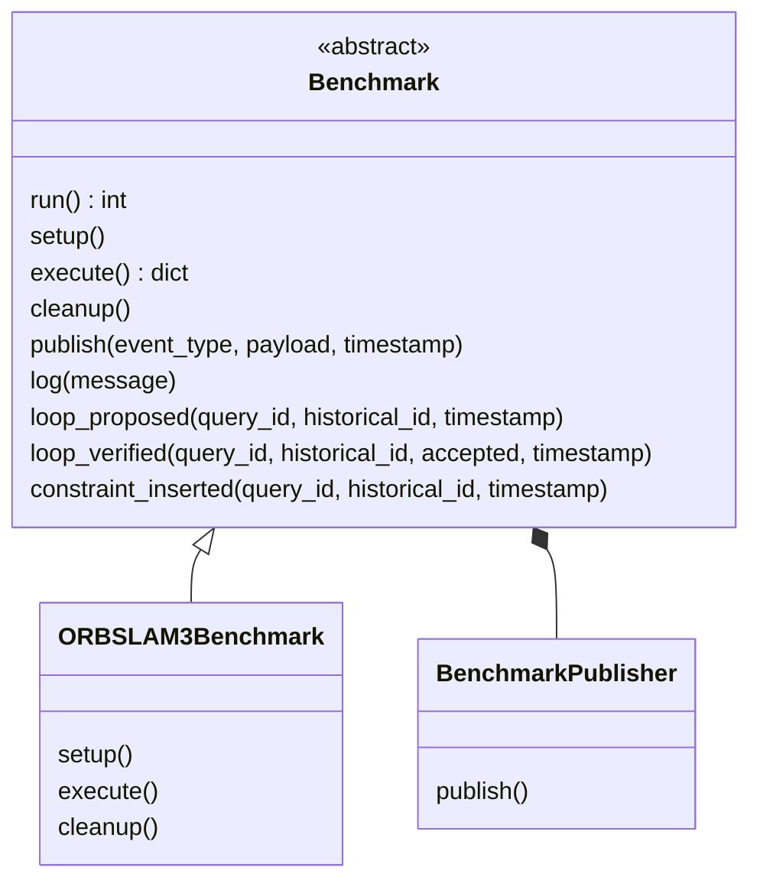

# Benchmark inheritance

The abstract `Benchmark` class in `evaluation/src/benchmarks/base.py` supplies the common lifecycle and event interface. Concrete adapters inherit it. The publisher is owned internally by the base class rather than recreated in every adapter.



`ORBSLAM3Benchmark` is planned; it is not yet a native implementation. Future concrete adapters such as OKVIS2 follow the same interface.

The inherited lifecycle is:

```text
run()
  -> publish started
  -> setup()
  -> execute()
  -> cleanup(), including after setup/execution failure
  -> publish completed or failed
  -> return process exit code
```

Only `execute()` is mandatory. Setup and cleanup default to no-op hooks. Keep `run()` inherited: it is a template method annotated as final, and owns lifecycle events. Publishing a terminal lifecycle event through the inherited measurement interface is rejected. Cleanup errors produce failure, rather than successful completion. An instance can run only once.

A concrete adapter's entry point calls `raise SystemExit(benchmark.run())`. `execute()` returns a JSON-compatible dictionary of result metadata or `None`; only real measured native events should be published. The inherited methods attach the adapter's sequence ID and forward to the existing stdout publisher. `publish()` handles additional measurements or richer payloads beyond the convenience methods. `log()` sends diagnostics to stderr.

The parent orchestrator still supervises subprocesses. It receives published messages and enqueues them in the singleton file handler. Inheritance shares Python behavior; it does not share the parent singleton's memory across processes.

The publisher can be injected for testing. Tests exercise inherited order, failure cleanup, lifecycle ownership, and publishing metadata. The synthetic subprocess used by the integration tests inherits `Benchmark`, verifying the same IPC/FIFO path future native adapters will use.
