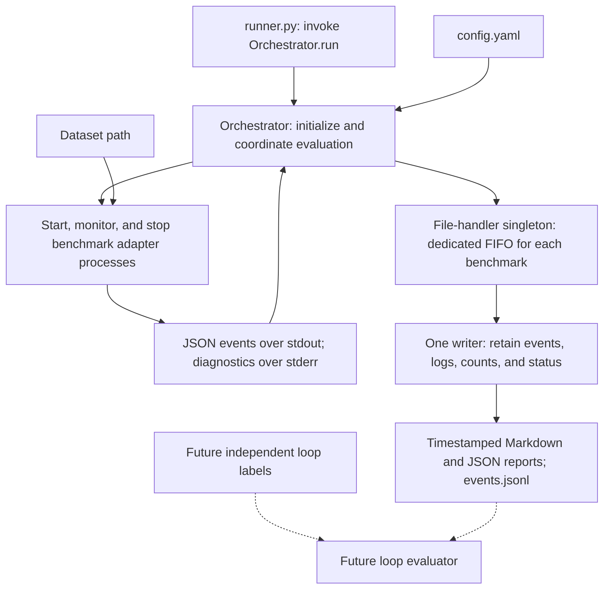

# Evaluation runner topology

Status: process supervision, IPC, per-benchmark FIFO queues, JSON and Markdown output writing are implemented. The active default is standalone ORB + DBoW2 image retrieval. The full ORB-SLAM3 adapter and its complete MH_01_easy runs are retained; independent loop scoring remains pending. See [retrieval topology](orb-dbow2-retrieval-topology.md).

## Input/output machine



The runner only invokes the orchestrator. The orchestrator initializes the run, supervises processes, validates received IPC events, and forwards them to the file handler. The file-handler singleton only organizes information and writes output; it does not manage subprocesses. It owns one bounded FIFO per benchmark and consumes them fairly with one writer. For the implementation contract, see [evaluation IPC](evaluation-ipc.md).

## Directory responsibilities

```text
evaluation/
  datasets/
    euroc/                       # Installed source data and installation manifest
  output/
    evaluation_<timestamp>_<id>.json
    evaluation_<timestamp>_<id>.md # Human-readable results from the same handler
    evaluation_<timestamp>_<id>/  # Supporting events, logs, trajectories, config snapshot
  src/
    runner.py                    # Minimal entry point
    modules/
      orchestrator/
        orchestrator.py          # Initialization and evaluation coordination
        process_group.py         # Native process-tree ownership and cleanup
      evaluation_file_handler/
        handler.py               # Singleton, FIFOs, serialized writing
        markdown_report.py       # Format report data for human readers
      benchmark_publisher/
        publisher.py             # Benchmark-side stdout publisher
      events.py                  # Shared JSON event protocol
    config.yaml                  # Run selection and parameters
    install_euroc.py             # Separate dataset installation utility
    benchmarks/                  # Adapters for existing SLAM implementations
    datasets/                    # Future dataset loading code; distinct from source data
    metrics/                     # Future loop matching and metric calculation
  tests/                         # Infrastructure integration tests and synthetic fixtures
```

The default configuration selects standalone ORB + DBoW2 retrieval on EuRoC MH_01_easy. An empty benchmark list fails before creating a report. Build locations and executables are configurable. Independent loop scoring remains planned.

## Human-readable report

The file handler generates an `.md` file next to each timestamped `.json` report, using the same run name. Its existing single writer updates both reports on status changes and after draining all FIFOs at shutdown. Each file is replaced atomically; the pair is not a transactional snapshot during a live run.

The Markdown report shows run status and dates, dataset root, configured seed, per-benchmark loop counts, execution duration, exit codes, errors, and all event-type counts. It links to the JSON report and retained raw events. Failed and running reports identify results as partial. TP, FP, FN, precision, and recall display `Not evaluated` while independent labels are unavailable. Geometric rejection does not imply a false positive, and repeated attempts are not deduplicated physical revisits.

## Configuration contract

| Section | Required settings |
|---|---|
| `run` | Seed, repeat count, execution mode, timezone. Default timezone: `Asia/Jerusalem`. |
| `dataset` | Dataset name, data root, exact sequence list, frozen split manifest when available. |
| `benchmarks` | Selected adapter names, native executable locations, revisions, sensor mode, baseline config paths. |
| `detectors` | Original or our detector, weights/revision, candidate budget, thresholds, optional sequence/IMU checks. |
| `evaluation` | Loop-label path and version, temporal exclusion, event grouping/matching policy, timing policy. |
| `output` | Results root, retained logs/events/trajectories, failure handling policy. |

Resolve relative paths against the project root, independent of the shell's current directory. Validate all selected data, executables, model files, and sensor configurations before starting a run. Dataset installation is a separate step.

## Benchmark adapter contract

Each adapter exposes the same conceptual interface:

```text
prepare(dataset_selection, benchmark_config, detector_config)
execute(run_context) -> event stream + trajectory + execution status
cleanup()
```

Adapters translate dataset inputs and capture native-system outputs. The common event format must identify the benchmark, detector variant, sequence, repeat, keyframe IDs, dataset timestamps, proposal scores, geometric acceptance, and constraint insertion. Include processing latency and failure details where available.

Instrumentation must capture proposals before geometric verification. A final trajectory alone cannot tell us how many correct or incorrect proposals a detector made. If a native implementation does not expose a measurement, mark it unavailable with a reason; do not fabricate it from trajectory changes.

## Execution modes

**Detector replay:** record a fixed keyframe stream and evaluate the original and replacement detectors on that same input. This isolates detector quality. Images and short-term motion must be supplied as they were available at that point in the sequence.

**Integrated SLAM:** run the full system with each detector variant using the same dataset, sensor mode, and baseline settings. Measure downstream trajectory accuracy and failures. Different loop decisions can change subsequent keyframes, so also report the actual keyframe count and eligible loop opportunities for each run.

Ground truth is consumed by the evaluator, after detector decisions. Never supply test loop labels or ground-truth poses to our runtime detector.

## Dataset loading

For EuRoC, retain integer nanosecond timestamps, camera calibration, and IMU frame conventions. Match stereo images by shared timestamps and report unpaired frames. Keep the source data unchanged.

Provide camera observations and intervening IMU samples in timestamp order, or hand the sequence to the native system's supported dataset reader. Do not interpolate away the IMU stream or assume camera and IMU sample rates are equal. Record whether execution is dataset-paced or unrestricted offline processing when reporting timing.

## Orchestrator and handler lifecycle

1. Load and validate the configuration and required files.
2. Capture the timezone-aware start time, generate a unique run ID, and create the report with status `running`.
3. Save the resolved configuration, selected sequences, seed, hardware, model revisions, and native benchmark revisions.
4. Execute the configured benchmark × detector × sequence × repeat combinations, retaining raw events and outcomes.
5. Evaluate labelled observations and group distinct revisit events using the declared policy.
6. Produce per-case metrics and aggregate summaries with their counts and denominators.
7. Finish with status `complete`, `partial`, or `failed`, including errors and references to supporting artifacts.

The orchestrator initializes and supervises the processes, forwarding events and process outcomes to the handler. The handler exclusively writes the shared output. Benchmark subprocesses never open the report. It serializes received events, updates reports atomically at status changes and finalization, and drains pending messages before finalization. Failed runs remain in the report. A fixed seed improves reproducibility but does not guarantee deterministic behavior in threaded native SLAM implementations; repeated runs measure variation. Automatic repeats and labelled metric aggregation remain future work.

## Timestamped result file

Use the run's **start time** to name its report:

```text
evaluation/output/evaluation_YYYY-MM-DD_HH-mm-ss_ffffff_<run-id>.json
```

Example filename:

```text
evaluation_2026-10-02_14-30-00_123456_a1b2c3d4.json
```

Use a Windows-safe filename, microseconds, and a random ID suffix to avoid collisions. Create it exclusively so an existing report is never overwritten. Store the full ISO 8601 local start/end times with UTC offsets, the IANA timezone, and UTC timestamps inside the report. Measure processing durations with a monotonic clock.

One top-level report contains all configured cases in that invocation. Supporting files go into a directory with the same stem. Update the report atomically through a temporary file as cases complete; an interrupted run retains its last saved progress.

## Report contents

| Field group | Contents |
|---|---|
| Identity | Schema version, run ID, status, local/UTC timestamps, timezone. |
| Provenance | Resolved config, seed/repeats, dataset manifest, split and label versions, benchmark/model revisions, hardware. |
| Cases | Benchmark, detector, sequence, repeat, exit status, errors, keyframe count, raw proposal count. |
| Detection metrics | Pair/event TP, FP, FN, precision, recall, F1, distinct loop events, false proposals per hour, detection delay. |
| Downstream metrics | Geometric acceptances, inserted constraints, accepted false loops, trajectory errors, tracking failures. |
| Runtime | Retrieval/pair-scoring/full-detector latency, native execution time, memory, timing policy. |
| Aggregates | Per-sequence summaries and clearly defined pooled or averaged metrics. |
| Artifacts | Paths to event logs, native logs, trajectories, and configuration snapshots. |

Use `null` with an availability reason for metrics that cannot be computed. In particular, without independent loop labels, raw proposal and acceptance counts are reportable, but TP/FP/FN and loop precision/recall are unavailable. Zero denominators are also undefined, rather than zero performance.

## Decisions before implementation

Choose the first native baseline and build environment, the original-detector instrumentation point, and the ground-truth loop-label policy. The infrastructure has been verified with synthetic subprocesses. Configure a real adapter and start with one sequence before expanding to the frozen evaluation set. Proposal counts are available now; TP/FP/FN require the future independent evaluator.
