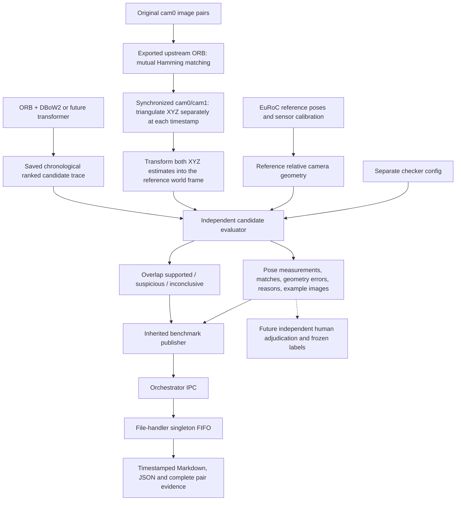

# Independent candidate evaluation

Current implementation: policy version 8 evaluates individual ORB correspondences without temporal RANSAC. See [feature XYZ evaluation](feature-xyz-evaluation.md). The earlier workflow below is retained as historical documentation.


Status: version 2 is implemented and enabled after standalone ORB + DBoW2 retrieval. Stereo XYZ/world consistency is the primary outcome; version 1's 2D checks are retained as separate evidence.
This is a diagnostic evidence checker. It does not create definitive loop
ground-truth labels or compute precision/recall.

## Input/output machine



The checker runs after native retrieval finishes. Reference data never enters
the detector's selection, ranking, or descriptor computation. The checker
does not use a DBoW2 score, ORB descriptors, learned features, or the detector's
own acceptance flag to classify a pair. Rank is retained for reporting only.

## Checks

1. Join candidate pairs to the exact saved image replay by integer timestamps.
2. Match each timestamp to a reference pose within 10 ms; leave missing poses
   inconclusive. Preserve actual pose timestamps and matching errors.
3. Convert reference sensor pose to cam0 using both ground-truth and camera
   `T_BS` extrinsics. Camera lever arms matter when the body rotates.
4. Load the exported upstream ORB features mapped back to raw sensor pixels; retain only mutual Hamming ratio matches.
5. For each timestamp, independently match the cam0 feature to synchronized cam1
   using mutual ORB ratio matching. Missing cam1 images remain inconclusive.
6. Undistort observations using each camera's own calibration. Triangulate with
   normalized projection matrices `[I|0]` and `[R_C1C0|t_C1C0]`, derived from both
   camera/body extrinsics. XYZ is in original cam0 axes, not rectified axes.
7. Reject nonfinite points, negative depth in either camera, depth outside
   0.25–50 m, stereo reprojection above 2 px, parallax below 0.5°, or relative
   depth standard deviation above 0.25.
8. Propagate assumed 1 px measurement noise through the triangulation Jacobian.
   Add assumed reference-position sigma 0.03 m and orientation sigma 1° when
   rotating point covariance into the world frame. These are explicit modeling
   assumptions, not dataset-provided uncertainty estimates.
9. Transform both estimates with their independently associated reference
   camera poses: `P_W = T_WB * T_BC * P_C`. Compare covariance-weighted XYZ error
   and reproject each world point into the other view, checking both directions.
10. Require enough reliable, distributed landmark agreement for support. Keep
   missing/unreliable depth inconclusive. Retain all candidate pairs.

The 2D epipolar/rotation/homography checks are still measured independently and
stored as `two_d_outcome`/`two_d_reasons`; they do not override insufficient depth
in the enabled stereo mode. Set `stereo_enabled: false` to run the previous 2D
diagnostic mode explicitly.

## Outcomes

| Outcome | Meaning | Accuracy label |
| --- | --- | --- |
| `overlap_supported` | At least ceil(0.4 × post-RANSAC ORB matches) landmarks agree in world XYZ and bidirectional reprojection | Unknown |
| `suspicious` | At least ceil(0.4 × post-RANSAC ORB matches) reliable paired-depth landmarks, but at most 10% satisfy XYZ and reprojection checks | Unknown; possible false positive |
| `inconclusive` | Pose/right image is missing, reliable depth is sparse, or consistency is ambiguous | Unknown |

XYZ agreement uses squared Mahalanobis error at most 11.345; bidirectional
cross reprojection must be at most 7 px. Policy version 7 removes cell/grid
coverage from support and rejection decisions. These remain **provisional diagnostic
thresholds**, not validated paper benchmark rules.

Stereo reconstructs estimated landmark XYZ, not ground-truth feature XYZ. The
reference trajectory anchors the estimates to a shared coordinate frame.
First-order covariance ignores calibration error and correlated reference-pose
errors. The model therefore does not guarantee a calibrated false-positive rate.
The fixed cross-reprojection gate is another provisional diagnostic threshold.

Distance and orientation are reported for context. Neither a large distance nor
geometric failure alone is used to declare a false positive. Blur, exposure,
viewpoint changes, calibration, ground-truth timing and orientation uncertainty
can affect the result. In MH_01_easy, the ground-truth sensor description says
orientation is observed by the IMU; this is a limitation of reference geometry.

## Module and shared interface

`evaluation/src/tasks/feature_matching/xyz/`

- `poses.py`: reference pose association and sensor/camera transforms.
- `geometry.py`: exported native ORB features, matching, reference errors and outcomes.
- `stereo.py`: synchronized stereo reconstruction, reliability/covariance,
  reference-world comparison, cross reprojection and 3D outcomes.
- `evaluator.py`: trace replay, provenance, pair evidence and example exports.
- `config.yaml`: checker policy, independently configurable from the detector.
- `__main__.py`: offline rechecking of a saved detector trace.

`Benchmark.evaluate_candidates(...)` provides the shared integration method.
Future detector adapters can inherit it. The orchestrator continues supervising
the benchmark process; the file handler continues owning all report writing.

## Output contract

Events: `candidate_check_started`, `candidate_checked`, and
`candidate_check_completed`. A pair contains query/historical timestamps,
rank, outcome, reasons, independent feature/match measurements, reference pose
evidence, image hashes and `accuracy_label: null`. Stereo events carry reliable
and consistent landmark counts, ratios, coverage, median XYZ/reprojection
errors, depth rejection reasons and exact right-image hashes. Full landmark
arrays stay in `pairs.jsonl` to keep IPC messages bounded; events include the
evidence filename and line number.

Retained artifacts under each native run's `candidate_checks/`:

- `provenance.json`: policy, input/code SHA-256 hashes and library versions.
- `pairs.jsonl`: complete evidence for every returned candidate, including
  each landmark's image coordinates, local/world XYZ estimates, metric error,
  covariance-weighted error, assumed three-sigma radius, cross reprojection
  errors and consistency decision.
- `summary.json`: outcome/rank/reason counts and checker runtime.
- `example_<outcome>_<n>.png`: query/history images for review.

The file handler checks that summarized pairs match received pair events and
that the completed checker covered all returned retrieval candidates. Checker
runtime is separate from native retrieval timing.

## Offline command

From `evaluation/src/` inside WSL:

```sh
/opt/loop-detector/python-env/bin/python -m tasks.feature_matching.xyz \
  --sequence /opt/loop-detector/datasets/euroc/MH_01_easy \
  --replay <saved-replay.tsv> \
  --trace <saved-retrieval.jsonl-or-publisher-events.jsonl> \
  --output <new-check-directory>
```

The checker accepts the shared `retrieval_query` event contract or raw native
query JSONL. It requires a complete chronological replay. Use a new output
directory for each check; retained evidence is never overwritten.

## Next step for actual accuracy

Review the flagged and ambiguous cases independently, label positive/negative
visual-overlap pairs, and freeze the labeling policy before comparing models.
Also label eligible pairs outside the returned candidates; reviewing only
retrieved pairs cannot measure missed loops or recall. Split validation/test
data before selecting thresholds. Do not count inconclusive pairs as negatives.

Dataset source: [ETH EuRoC MAV dataset](https://projects.asl.ethz.ch/datasets/euroc-mav/).
Frame conventions and calibration are read from installed sensor YAML files;
the EuRoC publication describes the ASL dataset format.
