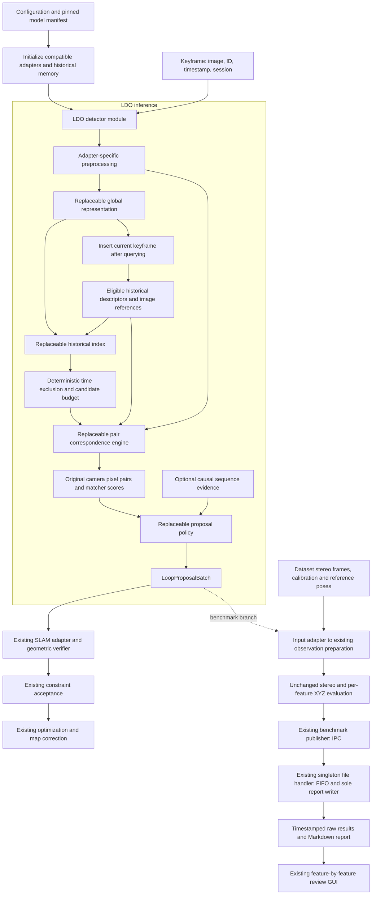
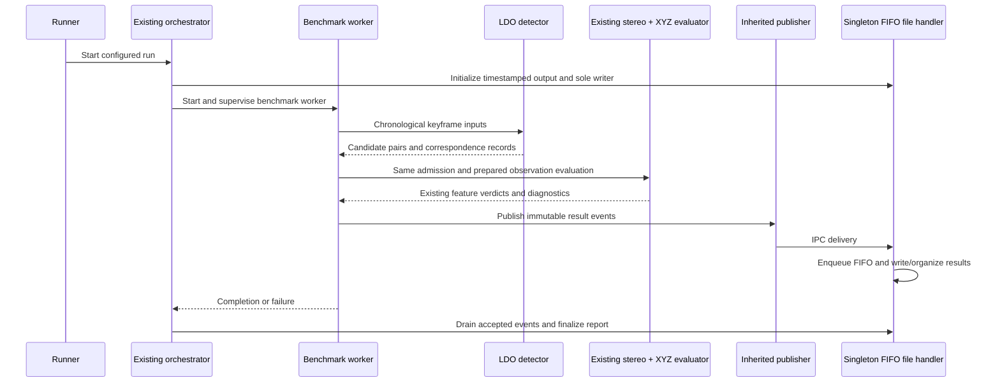

# LDO architecture: end-to-end algorithm plan

Date: 2026-10-03. Status: architecture contract. The first pretrained configuration, standalone benchmark, unchanged XYZ evaluation and feature review are implemented and verified. See [implementation and recorded results](ldo-implementation.md). Native SLAM integration and trained LDO variants remain subsequent milestones.

## 1. LDO is the approach

**LDO is the architecture for discovering visual revisit candidates and proposing useful feature correspondences to an existing SLAM system.** Its identity does not depend on one pretrained transformer.

A concrete LDO configuration selects the visual representation, historical search, local matching and proposal policy. Those implementations can change while preserving the interfaces and evaluation contract. Later configurations may use fine-tuned weights or transformers trained specifically for LDO.

### Naming

| Name | Meaning |
| --- | --- |
| `LDO` | Architecture, project and stable input/output contracts. |
| `LDO-MegaLoc-LightGlue` | First proposed configuration: MegaLoc global retrieval and SuperPoint-compatible LightGlue local matching. |
| Future `LDO-<retrieval>-<matcher>` | Another configuration, including our own trained implementations. |

The display name is a readable label. A machine-readable manifest also records the extractor, code revisions, checkpoint hashes, preprocessing, descriptor schema, policy and evaluator revision. Distinct weights/configurations must have distinct manifest identities even when their display names match. The project directory is named LDO; switching a model does not rename the project.

## 2. Goal and responsibility

Input: chronological visual keyframes from replay or an existing visual–IMU SLAM estimator.

Output: ranked historical keyframe proposals and their reported feature correspondences, with scores, timing and provenance.

LDO must improve candidate discovery and/or useful correspondence evidence at a declared cost and false-proposal operating point. Returning more candidates or more features alone is not sufficient.

The existing estimator owns keyframe generation, tracking, IMU processing and motion estimation. The existing loop backend owns geometric verification, relative pose estimation, constraint acceptance and correction. The benchmark owns offline reference-pose and XYZ evaluation.

## 3. End-to-end topology



The live branch never receives reference poses or evaluator verdicts. The benchmark branch uses them only to judge already reported correspondences. Benchmark supervision and output writing use the current orchestrator/publisher/file-handler design.

## 4. Public detector interface

The detector is a stateful module with a small interface:

```text
initialize(configuration, adapters) -> manifest
process_keyframe(KeyframeInput) -> LoopProposalBatch
reset(session_configuration)
close()
```

The surrounding worker invokes `process_keyframe` serially for one detector instance. It supervises scheduling and failures. The detector owns descriptor history, candidate evidence and bounded caches; it does not supervise benchmark processes or write the shared evaluation output file.

### KeyframeInput

| Field | Meaning |
| --- | --- |
| `keyframe_id` | Stable identifier scoped to a session. |
| `session_id` | Identifies the time domain and historical memory. |
| `timestamp_ns` | Capture timestamp; not processing time. |
| `image_reference` | Accessible original camera image. |
| `camera_id`, `image_size`, `pixel_domain` | Explicit camera and coordinate convention. |
| Optional `local_motion` | Estimator-provided short-term motion with convention and uncertainty. |

Initial LDO inference consumes cam0 imagery. Stereo cam1, calibration and reference poses are benchmark preparation inputs, not required inference inputs. Raw IMU processing stays in the existing estimator. Cross-session retrieval is disabled initially; enabling it requires an explicit history and timestamp policy.

### LoopProposalBatch

```text
query_keyframe_id, session_id, timestamp_ns
status: completed | skipped | failed
reason                         # Required for skipped/failed
candidate_records[]            # Retrieval results, including zero-match pairs
  historical_keyframe_id
  retrieval_rank, retrieval_score, retrieval_score_definition
  correspondences[]
    query_observation_id, historical_observation_id
    query_xy_original, historical_xy_original
    matcher_score, matcher_score_definition
    representation_family
  pair_evidence                # Counts and score summaries
  proposal_decision, decision_reason
proposals[]                    # References to emitted candidate records
timings, manifest_id
```

Zero-match candidate records remain visible in retrieval reporting. A correspondence observation ID belongs to the selected representation; it must not imply a native ORB map landmark identity. `completed` with an empty proposal list is different from a failed or skipped job.

Model scores are not automatically physical-match or loop probabilities. Every score records its definition. Adding a calibrated probability requires labelled development data and a separately versioned calibration adapter.

## 5. Replaceable modules and internal interfaces

| Module | Interface | First implementation | Replaceability rule |
| --- | --- | --- | --- |
| Global representation | `encode(image) -> GlobalRepresentation` | Pretrained MegaLoc | Declare dimensionality, normalization, similarity metric and checkpoint/preprocessing identity. |
| Historical index | `query(descriptor, eligibility, budget)` and `insert(record)` | Exact cosine search | Same logical ranking contract; approximate indexes require recall/resource measurement. |
| Pair correspondence engine | `match(query_image, historical_image) -> CorrespondenceBatch` | SuperPoint + LightGlue | Return original pixel pairs, score definitions and provenance regardless of internal architecture. |
| Local extractor, inside sparse pair engine | `extract(image) -> LocalFeatures` | SuperPoint | Extractor and matcher checkpoints must be compatible; validate their declared feature schema. |
| Sparse matcher, inside sparse pair engine | `match_features(query, historical) -> assignments` | SuperPoint-specific LightGlue | Cannot substitute arbitrary ORB descriptors into a pretrained checkpoint. |
| Proposal policy | `decide(candidate_records, causal_state) -> decisions` | Deterministic retrieval ordering initially | Record policy revision and operating points; a learned policy obeys the same output contract. |
| SLAM adapter | `submit(proposal) -> native_outcome` | Later ORB-SLAM3 integration | Preserve the native verifier's representation and map-association requirements. |
| Benchmark observation adapter | `prepare(correspondences, dataset_context)` | Adapter to current preparation | Convert input representation only; leave stereo/XYZ rules unchanged. |

The pair correspondence engine is the common seam for both sparse and detector-free models. EfficientLoFTR or RoMa can replace the whole engine without pretending they implement an independently cacheable SuperPoint extractor. Their native outputs are translated to the same pixel-pair contract.

Replaceability means swapping a compatible adapter/configuration. It does not mean all checkpoints accept the same tensors or descriptors. Unsupported combinations fail at initialization with a specific compatibility reason; there is no silent fallback to a different algorithm.

## 6. First configuration

Conceptual configuration, not an executable config file or installed dependency declaration:

```yaml
architecture: LDO
variant: LDO-MegaLoc-LightGlue

retrieval:
  representation: megaloc
  weights: pretrained
  index: exact_cosine
  temporal_exclusion_seconds: 20
  top_k: 5

matching:
  engine: sparse_features
  extractor: superpoint
  matcher: lightglue
  checkpoint_feature_family: superpoint
  maximum_keypoints: 1024

proposal_policy:
  implementation: retrieval_order_with_match_evidence
  sequence_support: disabled_initially

evaluation:
  implementation: existing_stereo_xyz
  policy: same_pinned_policy_as_orb_baseline
```

Code/checkpoint hashes, exact model preprocessing and the existing evaluator configuration hash are resolved into the run manifest before execution. Official default matcher filtering is logged and later swept; it is not a hidden evaluation gate. Candidate budgets 20/50 and feature budgets 512/2048 are separate comparison settings, not assumed improvements.

MegaLoc uses its documented preprocessing and descriptor space. The local extractor uses its own compatible preprocessing. The adapter restores local matches to original camera pixels. No geometric computation uses MegaLoc's resized retrieval image coordinates.

## 7. Chronological algorithm

1. Validate session, image access, keyframe identity and timestamp ordering. Reject duplicate IDs and record explicit processing errors.
2. Apply the selected global model's preprocessing and compute a descriptor with its representation fingerprint.
3. Build eligibility from past frames and temporal exclusion. Search before inserting the query. Recent frames must not consume the eligible top-K budget; apply exclusion within exact search or expand/filter approximate results appropriately.
4. Return up to K historical candidates, with recorded ranks/scores and zero-match diagnostics supported.
5. For each pair, fetch the historical image or compatible local cache and invoke the pair correspondence engine. Convert all returned positions into original camera coordinates, preserving subpixel values.
6. Record each reported correspondence and its score. Native learned unmatched predictions remain unmatched; the adapter does not fabricate pairs. Log match-filter settings and any invalid-coordinate rejection.
7. Apply the declared proposal policy. Initially retain retrieval ordering and expose local evidence without a new minimum-match, grid-coverage or temporal-RANSAC gate. Add evidence-based rejection/reranking only as measured, separately versioned policies.
8. Emit candidate records and loop proposals with timings and provenance. Preserve the query ID even if inference completes after tracking has advanced.
9. Insert the query descriptor/image reference after querying and matching. Update bounded caches and causal sequence state. Record whether insertion succeeded; never silently mix incomplete state with a successful result.

Inference is asynchronous relative to tracking but chronological within the detector worker. Queue limits and overflow behavior are explicit, and skipped keyframes are reported rather than hidden. No future images contribute to a query's decision.

## 8. Neural and deterministic topology

| Stage | Initial behavior | Future options |
| --- | --- | --- |
| Global encoding/aggregation | Pretrained neural representation with transformer backbone | Fine-tuned encoder, adapters, our own retrieval transformer. |
| Local extraction | Pretrained SuperPoint neural extractor | Compatible alternative or joint image matcher. |
| Correspondence assignment | Pretrained LightGlue transformer | Fine-tuned/custom transformer or another pair engine. |
| Search, eligibility and memory | Deterministic | Different index implementation with measured ranking/resource tradeoff. |
| Pair/proposal ranking | Deterministic initially | Learned match-set/pair-confidence module. |
| Sequence support | Disabled initially; optional causal bookkeeping later | Learned temporal evidence after an independent comparison. |
| Original-pixel mapping and provenance | Deterministic | Same contract for every adapter. |
| Stereo estimation in evaluation | Existing frozen pretrained stereo model | Fixed for the current comparison. |
| XYZ transformation, uncertainty and verdict | Existing deterministic checker | Fixed for the current comparison. |
| Native geometry and loop correction | Existing SLAM | Preserved implementation and logged integration changes. |

SuperPoint is not a transformer. LDO can combine neural extractors, transformers and deterministic algorithms. The architecture requires explicit interfaces and evidence, not a transformer for every calculation.

## 9. History, cache and swapping invariants

- A representation fingerprint includes model/checkpoint, preprocessing, dimension, normalization and metric. Comparisons within an index use one compatible fingerprint.
- Changing descriptor weights or preprocessing requires rebuilding/re-encoding history or starting a new index. Equal vector dimension alone does not establish compatibility.
- Local feature caches are keyed by image identity/hash, extractor/checkpoint, preprocessing and coordinate convention. Matcher-specific pair-conditioned features cannot be reused as independent features unless that adapter guarantees it.
- Dense stereo caches remain owned by the existing evaluation preparation, independent of which temporal matcher produced the query pixels.
- Model changes happen between runs or through an explicit drained reset/rebuild. There is no hot swap that mixes embeddings while work is pending.
- Keep descriptor storage and image references separate from bounded GPU/local-feature caches. Record eviction and reload costs.
- Allow resource budgets to vary by configuration, while measuring total detector latency, queue delay and memory. Do not assume separate encoders share weights or features.

## 10. Fixed stereo + XYZ evaluation contract

**The XYZ evaluation remains exactly the evaluator used for ORB + DBoW2.** The new input adapter changes only the source and representation of proposed correspondences.

Preserve all of the following for the direct comparison:

- Ground-truth/reference-pose admission and timestamp tolerance.
- Stereo model, rectification/calibration and synchronization behavior.
- Depth reliability gates and uncertainty assumptions.
- World transformation and covariance propagation.
- Mahalanobis threshold and per-feature supported/contradicted/untestable rules.
- Existing diagnostic reprojection behavior; it does not override the XYZ verdict.
- Per-feature reporting and feature-by-feature GUI navigation across image pairs.

For each reported pair of temporal pixels, prepare its stereo observation at the current timestamp and at the historical timestamp, then pass those observations to the existing numerical checker. The same frozen disparity evidence is reusable across algorithms; each algorithm may request depth at different feature pixels.

Missing reference poses exclude the image pair from XYZ evaluation and are counted explicitly. Missing reliable depth makes the individual feature untestable, never automatically incorrect. Contradicted observations remain evidence of suspected false correspondence, not exact feature-identity ground truth or automatic rejection of the entire image pair.

The evaluator must not feed reference poses, XYZ verdicts or reference-world errors back into production proposal selection. Any future evaluator revision is a separately versioned experiment requiring both methods to be rerun under that revision.

## 11. Evaluation/report topology



Workers use the existing publisher endpoint; they do not acquire their own writer singleton or write shared files. The singleton belongs to the writing process. The orchestrator supervises processes; the file handler owns serialization, FIFO draining and report generation.

Required result layers:

1. Retrieval candidates, empty queries, excluded pairs, ranks and timing.
2. Every reported feature correspondence, its model score and existing XYZ evidence.
3. Absolute supported/contradicted/untestable counts, testable coverage and contradiction rate among testable observations.
4. Independently labelled pair/event recall and false proposals, when those labels exist.
5. Native verifier acceptance and inserted constraints, when SLAM integration exists.
6. Hardware, cache/runtime measurements and complete run manifest.

More supported observations and lower contradiction rate must be considered alongside unknowns and output/runtime budgets. Feature evidence alone cannot count missed revisits. Repeated proposals of one revisit must not inflate distinct loop-event recovery.

## 12. Baseline matrix and fair comparisons

| Retrieval | Pair engine | Purpose |
| --- | --- | --- |
| Existing DBoW2 | Existing ORB mutual matcher | Current reference. |
| MegaLoc | Existing ORB mutual matcher | Isolate retrieval. |
| Existing DBoW2 | SuperPoint / LightGlue | Isolate correspondence matching. |
| MegaLoc | SuperPoint / LightGlue | First complete LDO configuration. |

Run all through the same pinned stereo + XYZ evaluation and chronological admission protocol. Fixed image-pair experiments compare matchers; full-history replay compares retrievers. Create independent visual-overlap/revisit labels for actual retrieval recall instead of defining truth from one algorithm's candidate list.

MH_01_easy is development data because we have inspected and adjusted the evaluation using it. Reserve complete missions/environments before selecting thresholds or training; a random seed does not create distribution shift. Report external-dataset camera geometry and reference coverage explicitly.

## 13. Path to our own trained transformers

LDO's interfaces remain stable as the learned implementation changes:

1. **Frozen pretrained configuration:** establish reproducible behavior and failure evidence.
2. **Confidence calibration or a small match-set head:** investigate only if local scores/pair decisions are the measured bottleneck. Compare against a simple statistical policy.
3. **Fine-tuning/adapters:** adapt retrieval or matching on disjoint training data, with compatible new representation fingerprints and rebuilt caches/indexes.
4. **Dedicated LDO transformer:** replace a global representation, pair engine or learned proposal policy using the same external contracts.

A prospective match-set transformer receives available image/feature evidence and produces per-match reliability and a separate pair score. It must not receive ground-truth poses or evaluator results during inference. Feature correspondence supervision and pair/revisit supervision are distinct. Untestable observations are masked from negative/positive labels unless another independent source supplies a trustworthy label.

Training requires declared data, splits, losses, checkpoint provenance and independent evaluation. Optimizing solely against our XYZ proxy is insufficient to establish real loop-detection improvement. Fine-tuned/trained weights create new named configuration revisions, not a new meaning of LDO.

## 14. Proposed code organization

Proposed files only; implementation follows this plan in a separate work step.

```text
ldo/
  detector.py                 # Public stateful detector module
  contracts.py                # Input, proposal, correspondence, provenance
  configuration.py            # Resolve compatible adapters and manifest
  retrieval/
    megaloc.py                # Initial global representation adapter
    index.py                  # Initial exact historical index
  matching/
    sparse.py                 # Sparse extractor/matcher composition
    superpoint.py             # Initial extractor adapter
    lightglue.py              # Initial sparse matcher adapter
  policy.py                   # Initial deterministic policy
  memory.py                   # History/cache ownership and fingerprints

evaluation/src/benchmarks/
  ldo/
    benchmark.py              # Existing benchmark base and publisher
    config.yaml               # Concrete LDO variant selection

evaluation/src/modules/
  candidate_evaluator/         # Existing stereo/XYZ evaluator retained
    ...                       # Add input compatibility at preparation seam
  orchestrator/               # Existing process supervision retained
  benchmark_publisher/        # Existing IPC publisher retained
  evaluation_file_handler/    # Existing singleton FIFO writer retained

.docs/
  ldo-architecture-plan.md    # This architecture contract
  ldo-model-research-plan.md  # Model selection research and rationale
```

Introduce additional adapters where an actual alternative is implemented; do not create empty abstractions for every possible model. Core orchestration must not branch on particular model names. Model-specific tensor preparation stays inside its adapter.

## 15. Implementation milestones and acceptance criteria

| Order | Milestone | Reviewable result |
| --- | --- | --- |
| 1 | Stable contracts and learned-pixel input adapter | Existing ORB evidence preserved; new coordinates reach the unchanged checker correctly. |
| 2 | Frozen SuperPoint/LightGlue pair engine | Same fixed pairs, same evaluator, timestamped report and feature viewer with provenance. |
| 3 | Frozen MegaLoc representation and chronological index | New retrieved pairs, complete candidate records and factorial comparison. |
| 4 | Independent labels and frozen splits | Retrieval/event recall and false-proposal operating points can be measured honestly. |
| 5 | Runtime/cache measurement and policy experiments | Tail latency, memory and accuracy/cost curves on our machine. |
| 6 | Existing SLAM integration | Candidate IDs submitted to native verification; acceptance and constraint insertion logged. |
| 7 | Justified adaptation/training | Separate configuration, declared supervision and independent holdout results. |

Important integration detail: the first native adapter can submit keyframe IDs and preserve ORB-SLAM3's own feature/map associations. Feeding learned correspondences directly into its verifier requires explicit map association/conversion work; pixel pairs alone are not native landmarks.

Done for the first configuration means reproducible candidates and correspondences, correct original pixel coordinates, unchanged evaluation, evidence visible in the existing report/GUI, no reference-data dependency in inference, and pinned manifests. Claims about better loop recall wait for independent opportunity labels; claims about improved accepted loops wait for native integration.

## 16. Related research

- [Model research and proposed experiments](ldo-model-research-plan.md).
- [Local matching release/compatibility research](ldo-local-matching-research.md).
- [Current feature-level XYZ evaluation](feature-xyz-evaluation.md).
- [MegaLoc official implementation](https://github.com/gmberton/MegaLoc).
- [LightGlue official implementation and supported feature families](https://github.com/cvg/LightGlue).
- [Glue Factory: training compatible local models](https://github.com/cvg/glue-factory).

Model selection is replaceable. The architecture and fixed evaluation contract are the shared basis for every LDO configuration.
