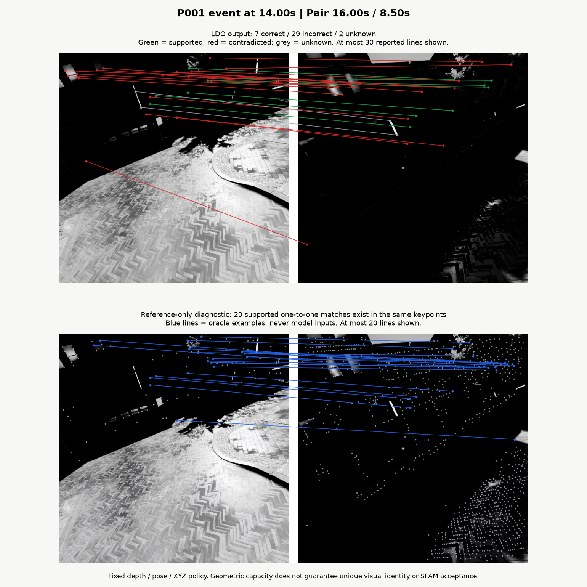
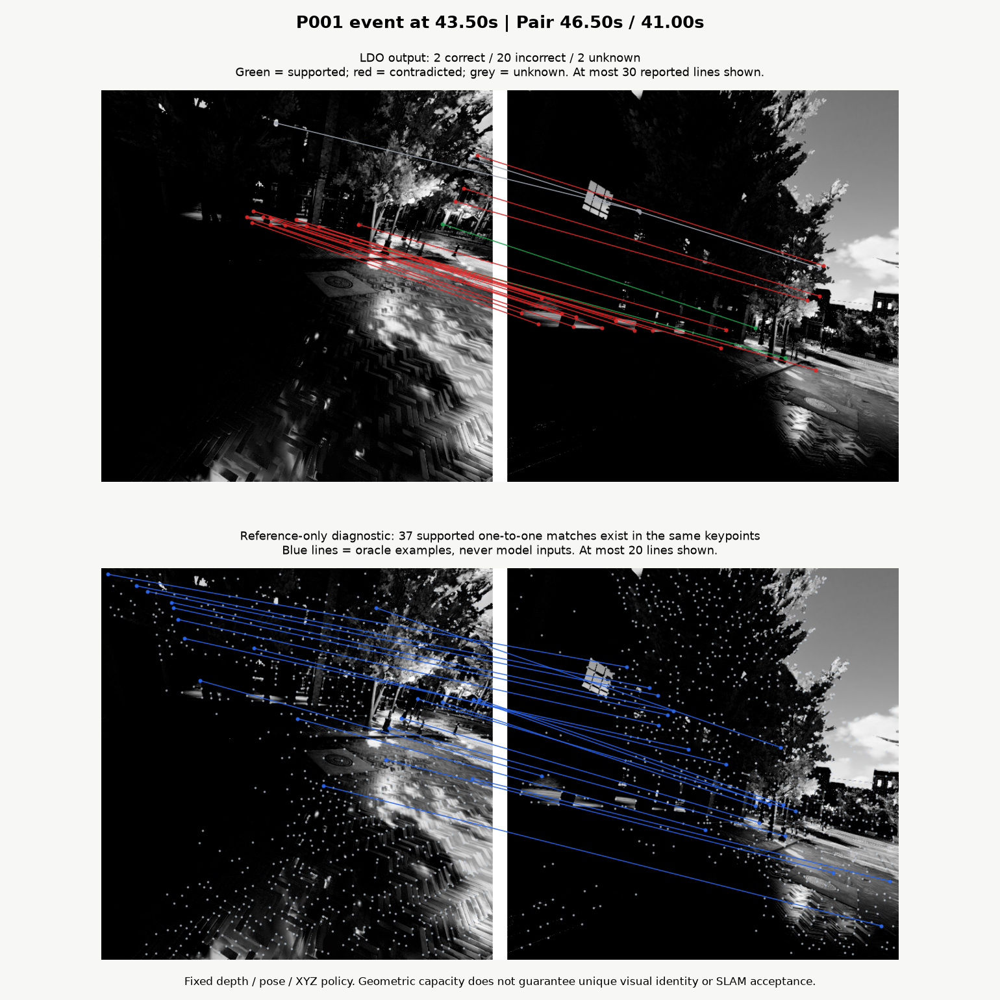
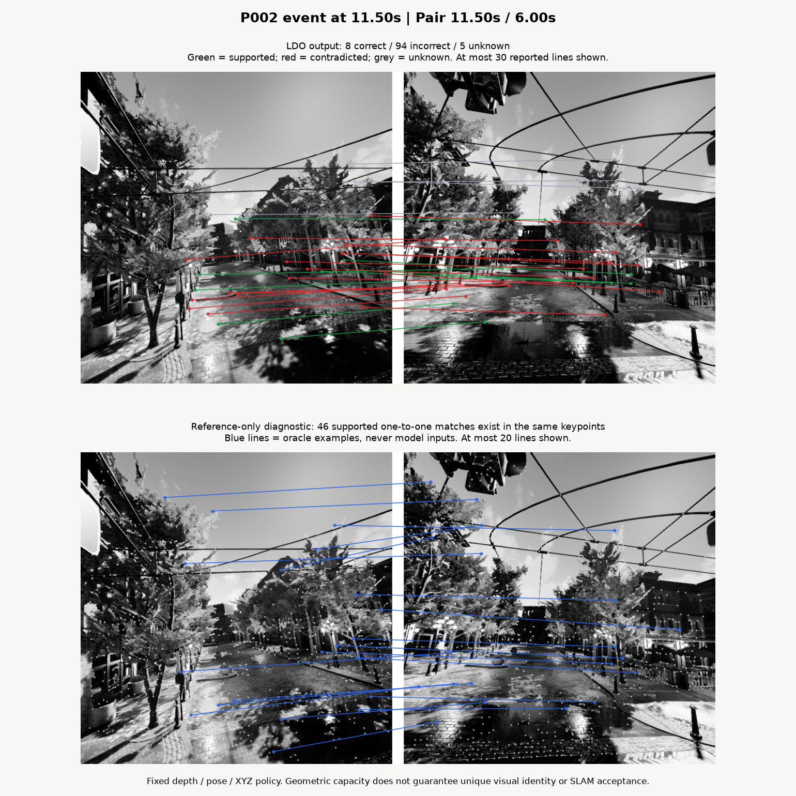

# LDO matching diagnosis: results

Completed 2026-10-10. The failure-analysis task ran on all four weak OldTownFall
events and all 352 pre-existing positive development pairs. No matching model was
changed or promoted. Baseline LDO remains at **13/17 usable events**.

## Main finding

**The main measured gap is association quality.** Three weak events have enough
geometrically supported one-to-one associations among the existing keypoints,
but the current SuperPoint/LightGlue pipeline recovers too few of them. One event
also has insufficient capacity with its current features.

| Trajectory / event start | Best reported correct matches | Maximum supported capacity using existing keypoints | Diagnosis |
| --- | ---: | ---: | --- |
| P001 / 13.00 s | 0 | 2 | Existing feature capacity below 20 |
| P001 / 14.00 s | 7 | 20 | Unused supported associations |
| P001 / 43.50 s | 3 | 37 | Unused supported associations |
| P002 / 11.50 s | 8 | 46 | Unused supported associations |

Both count columns are maxima over the event's retrieved positive pairs and can
come from different pairs. The generated report lists the individual pairs.

Capacity is measured by constructing a bipartite graph of geometrically supported
associations and solving maximum matching. A feature cannot be reused to inflate
the count. Every oracle edge passes the unchanged bidirectional depth, XYZ and
reprojection evaluator. Oracle associations never enter model inference.

An ideal reference-assisted assignment could meet the diagnostic in **16/17
events** with the current retrievals and keypoints. This is a geometric upper
bound. It is not an achieved model result, proof of distinctive descriptors or
a guarantee that a SLAM backend could accept the connection.

## What causes rejected matches?

Across the 30 weak-event pairs, actual model output contains **30 supports,
363 contradictions and 27 unknowns**.

- **336/363 contradictions (92.6%) have large geometric residuals.**
- Only **27** contradictions lie within twice both numerical gates. They remain
  rejected; the diagnostic band changes no verdicts.
- Missing reference evidence and small localization errors cannot account for
  most of these observed contradictions.
- The evidence isolates an association gap, but does not by itself distinguish
  ambiguous SuperPoint descriptors from LightGlue assignment behavior. A nearby
  geometrically supported feature need not have a unique visual identity.

The 13.0 s pair is different: **1,021/1,024 query features** and **1,018/1,024
historical features** have valid reference depth. However, only **21 query
features project inside the historical image**, and only **two** supported
one-to-one associations exist. Unavailable ground truth does not explain this
failure. Projection inside an image checks field of view; oracle edges also pass
the complete evaluator.

## Independent development confirmation

Factory and desert analysis uses the already frozen positive development pairs.
Zero-match pairs remain in the denominator.

| Split | Positive pairs | Currently meet 20 correct matches | Existing-feature capacity meets 20 | Sufficient capacity but insufficient reported matches |
| --- | ---: | ---: | ---: | ---: |
| Fit | 224 | 181 | 224 | 43 |
| Validation | 128 | 104 | 128 | 24 |

Overall, **67/352 development pairs** exhibit this association gap. All 352 have
geometric capacity of at least 20; 285 currently reach it. The pattern extends
beyond the four test examples. This does not establish that a new visual matcher
will recover every oracle edge.

## Visual examples

Top: actual LDO associations and their verdict colors. Bottom: reference-only
supported alternatives among the same keypoints. Blue lines are evaluator
examples, not model output. Displayed lines are labelled subsets; numerical
counts use every saved correspondence. Each figure uses the pair with greatest
geometric capacity in its event.

### P001 / 13.00 s


### P001 / 14.00 s



### P001 / 43.50 s



### P002 / 11.50 s



## Implemented program

```text
evaluation/src/tasks/matching_diagnostics/
  config.yaml       Original inputs, output root and fixed diagnostic boundary
  geometry.py       Reference graph, exact maximum matching and residual analysis
  workflow.py       Integrity checks, replay and report publication
  promotion.py      Event-preserving guard for future experiments
  report.py         Human-readable numerical report
  __main__.py       CLI entry point
evaluation/plot_matching_diagnostics.py   Optional scientific figures
```

Per-pair NPZ files retain original assignments, all keypoints, projected reference
positions, supported edges, a maximum assignment and unchanged reported verdicts.
JSON includes per-side depth reasons, residual quantiles, unused alternatives and
evidence hashes. Dated reports use the existing singleton FIFO file handler.

The future promotion utility checks replay/protocol consistency, fewer incorrect
matches, at least 90% correct-match retention per scene, and preservation of
**each baseline usable event ID**. Evaluate it independently on full fit and
validation replays. It is not a runtime model policy and does not modify the
historical experiment's selection.

## Next targeted experiment

Compare a pair-conditioned image matcher against SuperPoint/LightGlue on
development data. This addresses association quality while permitting new points
in shared image areas. For example, the [official EfficientLoFTR
interface](https://github.com/zju3dv/EfficientLoFTR#match-image-pairs-with-efficientloftr)
accepts two images and returns matched pixel coordinates and confidence scores.
It is a candidate to test, not a claim that it will outperform the baseline.

A pair-conditioned model needs its own adapter: points can vary with the partner
image. Do not reuse the sparse extractor's feature IDs or mix incompatible
descriptors. Keep MegaLoc retrieval and independent XYZ evaluation separate.
Select on development data, preserve baseline event IDs, then freeze before a
new environment test.

OldTownFall is now post-test explanation data for this hypothesis. Preserve its
original results, and do not count it as fresh validation of a model inspired by
this diagnosis. No training or alternative model inference was performed here.

## Verification

- Full WSL suite: **208 passed, 19 subtests passed**.
- Targeted lint and formatting checks passed.
- Oracle tests cover augmenting paths, one-to-one capacity, unused associations,
  unknown depth and failures that must remain rejected.
- Promotion tests reject swapping one usable event for another despite equal
  event totals.
- Recomputed verdicts equal original verdicts for all **382 analyzed pairs**:
  30 test and 352 development. Original source/configuration hashes were checked.
- Figures were rendered and visually inspected. Their manifest records
  numerical evidence, image, renderer and output hashes.
- `check` intentionally returns exit code 2 for baseline **13/17**. The analysis
  preserves the measured model weakness and does not manufacture new supports.

## Reproduction and artifacts

- [Implementation guide and commands](../evaluation/src/tasks/matching_diagnostics/README.md)
- [Plan](ldo-matching-diagnostics-plan.md)
- [Generated detailed report](ldo-matching-diagnostics-report.md)
- [Direct numerical results](ldo-matching-diagnostics-results.json)
- [Raw FIFO report JSON](ldo-matching-diagnostics-report.json)
- [Figure provenance](ldo-matching-diagnostics-figures.json)

Raw artifacts: `/opt/loop-detector/experiments/matching_diagnostics/v1`.
