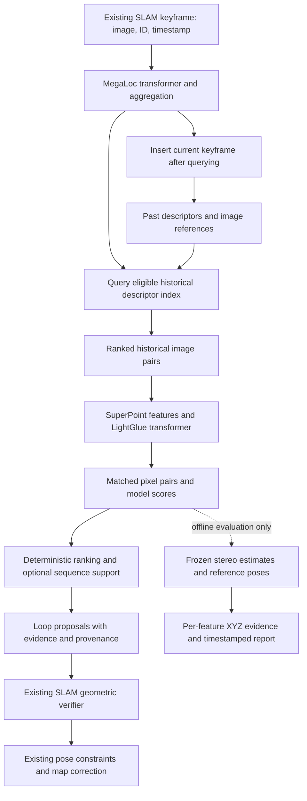

# LDO model: research and proposed implementation plan

Research date: 2026-10-03. Status: proposal for discussion. This document records research and design; it does not install models, implement the detector, or start training.

Architecture contract: [LDO end-to-end architecture plan](ldo-architecture-plan.md). LDO names the approach; individual model selections are replaceable configurations.

Implementation update: the first frozen configuration and evaluation integration are now implemented. See [verification and recorded results](ldo-implementation.md); the research proposals below retain their original scope.

## 1. Agreed objective

The user selected **find new candidate image pairs and improve their feature matches**. LDO therefore owns visual retrieval and correspondence proposal. The existing visual–IMU estimator owns tracking and motion estimation; the existing loop backend owns geometric verification, relative pose estimation, constraint acceptance and map correction.

The two hypotheses are separate:

1. Learned global descriptors recover genuine revisits that ORB + DBoW2 misses at a comparable proposal and runtime budget.
2. Learned local matching supplies more useful correspondences at a comparable contradiction rate, rather than merely supplying more matches.

Neither hypothesis has been demonstrated on our data yet. The current benchmark is the starting measurement, not evidence that a particular pretrained model already wins.

### Fixed evaluation contract

User requirement: retain the existing XYZ evaluation exactly as used for ORB + DBoW2. LDO changes the candidate retrieval and feature correspondence producer; it does not change the numerical XYZ checker, stereo backend, depth reliability gates, reference-pose admission, uncertainty assumptions, thresholds, or supported/contradicted/untestable verdict definitions for this comparison. Preserve per-feature reporting and navigation as well.

A matcher input adapter may translate learned feature IDs and pixel coordinates into the existing observation preparation interface. It must restore coordinates to the correct original camera domain and use the same stereo preparation and XYZ evaluation. This is input compatibility work, not a new evaluation algorithm. Any later evaluator revision requires a separately versioned experiment and rerunning both baselines under that same revision.

## 2. What our existing evidence establishes

Source: `evaluation/output/evaluation_2026-10-03_21-48-41_809677_235a491f.md`, current feature evaluator version 8.

| Measurement | Current ORB + DBoW2 experiment |
| --- | ---: |
| Retrieved image pairs | 1,635 |
| Pairs admitted with reference poses | 1,540 |
| Pairs excluded for missing reference poses | 95 |
| Reported correspondence observations | 54,702 |
| XYZ-supported | 22,309 |
| XYZ-contradicted | 2,286 |
| XYZ-untestable | 30,107 |
| Contradicted / testable | 9.29% |
| Testable / reported | 44.96% |

These are observations across pairs, including repeated landmarks. DBoW2 proposes image pairs; our mutual Hamming ratio matcher pairs exported upstream ORB descriptors. Those correspondences are not native ORB-SLAM3 accepted loop correspondences. This run contains no loop correction or native geometric acceptance.

The checker measures whether independently estimated stereo points agree after reference-pose transformation. It does not supply exact feature identity ground truth. Contradiction is evidence of a suspected false correspondence; insufficient reliable depth remains unknown. A candidate-only experiment cannot count the genuine revisits that retrieval never proposed.

MH_01_easy has already been inspected and used repeatedly for development. Treat it as development data. The replay currently uses 2 Hz, 20 seconds of temporal exclusion and top K = 5. A seed controls reproducibility; it does not establish an out-of-distribution test.

## 3. Research conclusion and first model choice

Recommended first prototype: **pretrained MegaLoc retrieval + pretrained SuperPoint / LightGlue matching**. This is a practical selection for our first experiment, not a claim of universal state of the art or proven superiority on EuRoC.

| Module | First adapter | Why it is in the plan |
| --- | --- | --- |
| Global image representation | MegaLoc | Released retrieval checkpoint and inference code; designed for several retrieval/localization tasks. |
| Historical search | Exact cosine search initially | Simple, reproducible ranking for our small replay; optimize the index only after measuring its cost. |
| Local image representation | SuperPoint | Produces sparse keypoints and descriptors compatible with a released LightGlue checkpoint. |
| Pair matching | LightGlue | Uses self/cross attention over local features and supplies explicit correspondences. |
| Proposal policy | Deterministic initially | Makes thresholds, budgets and temporal behavior inspectable. |
| Offline correspondence assessment | Existing frozen stereo + XYZ evaluator | Gives the same supported/contradicted/untestable evidence for every matcher. |

MegaLoc uses a DINOv2 transformer and learned aggregation. Its published inference produces 8,448-dimensional normalized descriptors using its documented RGB preprocessing. Training code/data are not released. It is suitable for our frozen inference experiment; recreating its training would be a separate undertaking. [Official inference and release notes](https://github.com/gmberton/MegaLoc), [model implementation](https://github.com/gmberton/MegaLoc/blob/main/megaloc_model.py), [paper](https://arxiv.org/abs/2502.17237).

LightGlue consumes compatible keypoints/descriptors and predicts matches; its available pretrained descriptor families do not include native ORB. SuperPoint itself is a neural local extractor, not a transformer. LightGlue provides the local transformer. Its matcher license and SuperPoint's separate terms must be recorded separately. ALIKED + LightGlue is an available alternative with a different extractor license. [Official LightGlue implementation](https://github.com/cvg/LightGlue).

### Comparisons worth preserving

- **SALAD**: global retrieval control with released checkpoints and training code. [Official repository](https://github.com/serizba/salad).
- **ImAge, NeurIPS 2025**: newer global representation with learned aggregation tokens and published training/checkpoints; useful if we later need our own retrieval adaptation. [Official repository](https://github.com/Lu-Feng/ImAge).
- **SAGE, ICLR 2026**: current global retrieval research alternative; evaluate its release maturity, inference behavior and resource needs before adding it. [Official repository](https://github.com/chenshunpeng/SAGE).
- **EfficientLoFTR**: complementary matching experiment that establishes matches from images without requiring SuperPoint detections. [Official repository](https://github.com/zju3dv/EfficientLoFTR).
- **RoMaV2**: dense matching comparator if resources permit; the release includes DINOv3 with separate license terms. [Official repository](https://github.com/Parskatt/RoMaV2).

These alternatives answer different questions; installing every method before obtaining a first measurement would not help select the architecture. Recent comparative research also reports domain-dependent strengths among VPR methods, supporting a benchmark on our actual imagery rather than choosing from one leaderboard. [2026 comparative study](https://arxiv.org/abs/2603.13917).

See [local matching research](ldo-local-matching-research.md) for detailed matcher interfaces, releases and license distinctions. A newer foundation backbone is not automatically interchangeable with an aggregation or matching checkpoint trained for another backbone.

## 4. Input/output machine



### Detector input

`KeyframeInput(keyframe_id, session_id, timestamp_ns, image_reference)`

The image is in the camera's original pixel coordinate system. Optional calibration and estimator-provided short-term motion have explicit frame conventions and uncertainty. Ground-truth poses are absent from this interface. Initial inference uses one visual stream; stereo and IMU remain available to the existing estimator and offline benchmark.

### Detector output

```text
LoopProposalBatch
  query_keyframe_id
  status                         # completed, skipped with reason, or failed
  proposals[]
    historical_keyframe_id
    retrieval_rank, retrieval_score
    correspondence_evidence[]
      query_feature_id, historical_feature_id
      query_xy_original, historical_xy_original
      matcher_score, extractor_family
    proposal_score_definition
    sequence_evidence
  timings, model_revision, checkpoint_hash, preprocessing_revision
```

A loop proposal is not an accepted loop constraint. Match scores, image similarities and any later calibrated pair probability are distinct quantities. A feature ID belongs to its extractor and keyframe; learned IDs must not masquerade as native ORB/map landmark IDs.

Every reported correspondence reaches offline evaluation. Learned matchability filtering is part of the declared algorithm and is logged; its score threshold is swept. There is no temporal RANSAC prefilter or image-cell acceptance gate in the evaluator.

## 5. Algorithm, step by step

1. **Prepare the image.** Use each checkpoint's own preprocessing. Replicate monochrome into RGB where required, without inventing color. Record all resizing, padding and coordinate transforms.
2. **Encode once.** Compute the normalized global descriptor. Cache local features when the selected extractor permits reuse. Global DINOv2 features and SuperPoint features are separate representations.
3. **Search only eligible past data.** Query before inserting the current frame. Exclude recent frames using timestamps, initially the existing 20-second rule. Do not use a radius around the drifting estimated global position to restrict retrieval.
4. **Shortlist historical images.** Start the direct comparison at K = 5; examine K = 20 and 50 as separate accuracy/cost curves. Both baseline and LDO receive the same historical universe and declared budgets.
5. **Match locally.** LightGlue uses within-image context and attention across the two feature sets to predict correspondence assignments, including leaving points unmatched. Keep the matched original pixel coordinates and individual scores.
6. **Produce proposals.** First retain retrieval ordering while exposing local evidence. Compare policies on development data before enabling a local-evidence rejection or reranking rule. Do not equate a fixed number of matches with a universal loop truth threshold.
7. **Accumulate optional temporal evidence.** Neighboring query frames proposing the same historical area can strengthen a hypothesis. Allow reverse traversal and different speeds; a strong isolated candidate need not wait for a sequence. Add this only after the independent stages have been measured.
8. **Emit and update memory.** Return proposals for the existing verifier, then index the current keyframe. Preserve IDs for delayed asynchronous results and distinguish worker backlog, failures and legitimate empty results.

For normalized descriptors, retrieval similarity is `s(q,h) = d_q dot d_h`. Learned local matching returns a set `M(q,h) = {(u_i, v_i, c_i)}` with original-image coordinates and model score `c_i`. Neither equation defines an accepted loop. Initial policy parameters are measured operating points, not claimed probabilities.

## 6. Neural versus deterministic responsibility

| Responsibility | Type |
| --- | --- |
| Global visual tokens and aggregation | Pretrained neural transformer / learned head |
| SuperPoint detection and descriptors | Pretrained neural extractor |
| Contextual correspondence assignment | Pretrained LightGlue transformer |
| Normalization, indexing, time exclusion, query ordering | Deterministic |
| Image-to-original-pixel coordinate mapping | Deterministic |
| Match uniqueness checks, budgets, threshold policy | Deterministic |
| Cache limits, asynchronous work and reporting | Deterministic |
| Initial sequence hypothesis bookkeeping | Deterministic |
| Stereo network used by our offline evaluator | Separate pretrained neural estimator |
| Triangulation, pose transformation, uncertainty and XYZ verdict | Deterministic offline evaluation |
| Relative pose, native verification and loop correction | Existing SLAM implementation |

### Why reference XYZ cannot be a production gate

Our evaluation computes `P_W = T_WB T_BC P_C` using reference poses. Live operation does not have those reference poses. Stereo gives depth within each camera rig; it does not establish the unknown transform between two separate visits. Existing estimated world poses may already contain the drift the loop is supposed to repair.

Consequently, reference-world XYZ is an offline judge of reported matches. A later production geometry module could use stereo observations with an estimated relative transform and uncertainty, but that would be a separate design and must not quietly reuse benchmark ground truth.

## 7. Training strategy and possible LDO research contribution

### First version: pretrained inference

Use released weights unchanged. This creates an executable neural detector baseline and reveals whether retrieval or correspondence quality is limiting us. We own orchestration, memory, evidence contracts, ranking experiments and evaluation. Combining existing models alone is not a demonstrated new learned architecture.

### Possible next learned module: match-set confidence

If false proposals remain after improved matching, investigate a small **set transformer confidence module** over the returned correspondences. Candidate inputs are both local descriptors, normalized pixel positions, matcher scores and global descriptor similarity. It could predict per-correspondence reliability and a separate pair score. Cross-match attention can consider ambiguity across the entire set instead of thresholding each descriptor distance independently.

This module is a research hypothesis. Its inputs must be available during inference; reference poses, reference-world errors and evaluator verdicts are labels/diagnostics only. The first implementation should also compare a simple statistical head, so any advantage of extra attention is measured.

Use independently supervised correspondence datasets or reviewed geometric evidence for training. XYZ-supported/contradicted observations can provide provisional supervision, with their uncertainty documented. Untestable observations are masked from positive/negative loss; they are never automatic negatives. Validate independently to avoid only learning to satisfy our stereo checker. A separately labelled image-pair objective is required for a pair score; feature labels alone do not define a false loop pair.

Only investigate retrieval adaptation if independent revisit recall is the bottleneck. SALAD/ImAge provide released training paths; a retrieval contrastive objective needs positive overlap labels and hard negatives from distinct places. Whole-scene development/test separation precedes training. Local matcher adaptation can use the official training framework. [Glue Factory training and evaluation](https://github.com/cvg/glue-factory).

No training from scratch is needed for the first LDO experiment. Training an optional head or adapters later requires a separate declared model variant and an untouched evaluation set.

## 8. Evaluation that can answer our actual goal

### Experiment A: correspondence quality on fixed image pairs

Run ORB mutual Hamming matching and SuperPoint/LightGlue on the same admitted pairs. Include a model-independent reviewed overlap set, not only DBoW2's suggestions. Reuse the same frozen dense disparity estimates, calibration and uncertainty policy, sampling depth at each algorithm's own original pixel coordinates.

Report absolute supported, contradicted and untestable counts; testable coverage; contradiction rate among testable matches; confidence-threshold curves; and supported yield versus runtime. Compare declared output budgets as well as each algorithm's natural output. Dense correspondences require reporting correlated/repeated samples so a dense grid does not artificially inflate useful evidence.

### Experiment B: retrieval of new pairs

Replay images chronologically and build the same eligible historical universe for each retriever. Establish independent revisit/visual-overlap labels before comparing rankings. Position proximity alone is insufficient. Use calibrated visibility/structure where available, complemented by documented review; preserve ambiguous labels.

Measure recall@K for queries with an eligible positive, pair precision/recall at declared operating points, distinct revisit events, false proposals per hour and detection delay. Ground-truth admission is shared across methods. XYZ assessment of returned matches remains complementary evidence, not the denominator for missed revisits.

### Experiment C: isolate the two replacements

| Retriever | Local matcher | Question |
| --- | --- | --- |
| DBoW2 | ORB mutual matcher | Current reference |
| MegaLoc | ORB mutual matcher | Retrieval contribution |
| DBoW2 | SuperPoint / LightGlue | Matching contribution |
| MegaLoc | SuperPoint / LightGlue | Combined proposed detector |

Preserve score provenance and original ordering at each stage. Evaluate optional reranking/sequence logic as separate ablations. The fair target is more independently confirmed revisits or useful feature evidence at the same false-proposal, latency and memory budget. More candidates alone is not success.

### Experiment D: existing SLAM integration

First hand candidate keyframe IDs to ORB-SLAM3's existing loop path and retain its native verifier. This tests candidate discovery while keeping the backend mathematics. Directly using learned correspondences additionally requires a native adapter: the verifier expects its feature/map landmark representation. Converting arbitrary pixel pairs into native map associations is not automatic.

Log detector proposals, native geometric acceptances and inserted constraints separately. Only this phase can measure actual downstream computation avoided, accepted loop events, and trajectory effects. Our offline XYZ check time is not a measurement of wasted SLAM work.

## 9. Data and runtime decisions

- Freeze split manifests by whole mission/environment. Another EuRoC sequence in the same building is held out from our tuning, but not necessarily a new domain.
- Consider TUM VI room sequences for an external test after adding its camera-model support: room trajectories have full reference coverage; most other sequences have reference measurements only at the beginning/end. Its fisheye geometry requires correct unprojection/rectification rather than reusing EuRoC pinhole assumptions. [Official TUM VI dataset](https://cvg.cit.tum.de/data/datasets/visual-inertial-dataset).
- Track known pretrained training data and unknown overlap. Do not claim verified out-of-distribution performance when source data cannot establish that.
- Preserve EuRoC's camera/IMU time and calibration conventions. Its official documentation notes independent camera auto-exposure; this is a potential stereo difficulty, not a proven explanation for a particular failure. [Official EuRoC dataset](https://projects.asl.ethz.ch/datasets/euroc-mav/).
- Our recorded machine has 8 GB GPU memory. Profile retrieval and matching sequentially first, then decide resident weights and cache budgets. Keep the evaluator's stereo model outside production runtime accounting.
- An 8,448-dimensional float32 descriptor occupies 33,792 bytes: 100,000 descriptors require about 3.38 GB before index overhead. Start with CPU descriptor storage and a bounded local-feature cache. Quantization/compression needs a separate measured recall comparison.
- Initial local-feature budget: 1,024 points/image; inspect 512 and 2,048 as resource curves. Published timings on other hardware are not our latency guarantee. Report warm/cold timings, p50/p95, peak GPU memory, index memory and queue delay.

## 10. Proposed code topology and order of work

Public detector interface: `process_keyframe(input) -> LoopProposalBatch`, plus documented lifecycle initialization/reset/close. This module owns historical state and caching. It receives model adapters and configuration during initialization; it never writes the shared evaluation file directly.

Internal seams exist where behavior actually varies: DBoW2/MegaLoc retrieval and ORB/LightGlue matching. Avoid building one class per arithmetic step. The benchmark adapter uses the existing base class and inherited publisher; the orchestrator supervises workers; the singleton FIFO file handler remains the sole shared report writer.

```text
ldo/                           # Proposed; not created in this planning step
  detector.py                  # Stateful chronological input/output module
  contracts.py                 # Keyframe, proposal and match evidence records
  retrieval/                   # Pretrained global representation + index
  matching/                    # Feature extraction + transformer matching
  policy.py                    # Explicit operating points and sequence logic
  config.yaml

evaluation/src/benchmarks/     # Existing benchmark location
  ldo/                         # Proposed adapter using existing benchmark base
```

Implementation order:

1. Define extractor-neutral pixel-pair evidence and add an input adapter to the existing observation preparation interface. Preserve the stereo algorithm, numerical XYZ checker, configuration and verdict rules used for ORB. Validate coordinate round trips and synchronized sampling at both visits.
2. Integrate frozen SuperPoint/LightGlue on fixed image pairs. Generate the existing Markdown report and feature viewer evidence with extractor provenance and all three XYZ verdicts.
3. Integrate frozen MegaLoc chronological retrieval. Reuse common admission and replay; run the factorial comparison above.
4. Freeze independent overlap/event labels and splits. Measure real missed revisits before selecting a proposal operating point.
5. Profile and compare SALAD/ImAge or another local matcher only where measured results leave a concrete question.
6. Add temporal evidence and native SLAM integration as separately measured changes.
7. Train our own confidence module or adapters only if the recorded failures justify it.

The project directory remains LDO. LDO names the architecture; variant metadata names the actual retrieval/matching checkpoints and extractor. The initial configuration is **LDO-MegaLoc-LightGlue**, using SuperPoint as the compatible extractor. The earlier “X” notation is a placeholder for the chosen models, not a fixed literal suffix. Future variants can use our fine-tuned or dedicated transformers through the same interfaces.

## 11. Completion criteria for the first prototype

- Same chronological replay, admission policy and budgets as the baseline.
- Every emitted correspondence has original-image coordinates and model provenance and appears in the existing feature review workflow.
- Reports separate recovered candidate pairs, feature evidence, unknowns, native acceptance and runtime.
- Production inference has no ground-truth dependency.
- Results can be reproduced from pinned code/checkpoint/configuration/split hashes.
- Conclusions state which measured stage improved and where evidence remains incomplete.

The immediate recommendation is steps 1–3 with frozen weights. The independent label work is required before claiming better loop recall; our existing feature checker can support correspondence experiments sooner.
