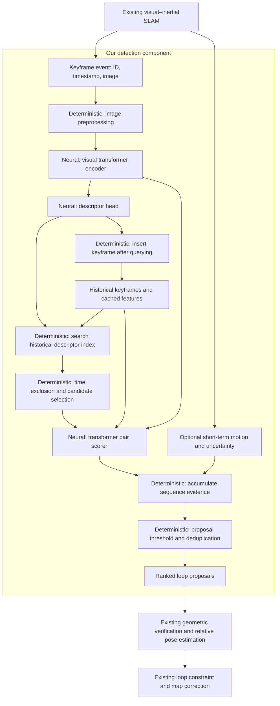

# Visual–IMU loop detector topology

Status: proposed architecture for discussion; no implementation or trained model selected yet.

The current end-to-end contract is the [LDO architecture plan](ldo-architecture-plan.md), which defines replaceable modules, named configurations, fixed XYZ evaluation and future dedicated-transformer training. This earlier topology remains conceptual background.

Research update (2026-10-03): the user prioritized finding new candidate image pairs and improving their feature matches. The [current model research and implementation proposal](ldo-model-research-plan.md) recommends evaluating frozen MegaLoc retrieval with SuperPoint/LightGlue matching first, and defines correspondence evidence in the output. This remains a proposal, with no model installation or training started. The [local matching research](ldo-local-matching-research.md) records alternatives and compatibility details.

## Goal and boundary

Detect more genuine revisits in an existing visual–inertial SLAM system while keeping false loop proposals low. Our component consumes keyframes and returns ranked pairs of current and historical keyframes.

The existing SLAM system creates keyframes. Its existing loop path verifies geometry, estimates relative pose, adds constraints, and corrects the map.

## Input/output machine



The historical candidate must remain accessible as an image or as cached features compatible with the pair scorer. A descriptor alone is sufficient for retrieval but may be insufficient for pair scoring.

## Component contract

### Input: keyframe event

| Field | Required | Meaning |
|---|---|---|
| `keyframe_id` | Yes | Stable identifier used by the existing SLAM system. |
| `timestamp` | Yes | Capture time in a documented time unit. |
| `image` or accessible image reference | Yes | Camera image associated with this keyframe. |
| `session_id` | When needed | Distinguishes mapping sessions and their time domains. |
| `local_motion` | Optional | Short-term relative motion from the existing visual–IMU estimator, with frame convention and uncertainty. |

IMU preintegration, bias estimation, and camera–IMU calibration belong to the existing estimator. The initial detector consumes its motion output rather than processing raw IMU measurements.

### Output: loop proposal batch

```text
LoopProposalBatch
  query_keyframe_id
  proposals[]                 # Empty when no candidate passes the policy
    historical_keyframe_id
    retrieval_score
    pair_score
    sequence_support          # Supporting observations and their strength
    decision_score
```

Scores are model or policy scores, not guaranteed calibrated probabilities. Their definitions and ranges must be fixed when an implementation is selected. The output proposes a revisit; acceptance as a pose constraint belongs to the existing geometric verifier.

## Neural and deterministic responsibilities

| Stage | Type | Input → output | Responsibility |
|---|---|---|---|
| Image preparation | Deterministic | Image → normalized tensor | Resize and normalize according to the chosen model. |
| Visual encoder | Neural transformer | Image tensor → visual tokens | Learn visual representations robust to appearance and viewpoint changes. |
| Descriptor head | Neural | Visual tokens → global descriptor | Produce a compact representation for retrieval. The head may use pooling or learned aggregation rather than another transformer. |
| Historical search | Deterministic | Descriptor + index → ranked candidates | Search descriptors by similarity; use exact or approximate nearest neighbors. |
| Candidate selection | Deterministic | Ranked candidates + metadata → top-K eligible candidates | Exclude recent frames and retain a diverse candidate set across historical areas. |
| Pair scorer | Neural transformer | Current + historical visual features → pair score | Use attention across the two images to judge whether they depict the same place. |
| Sequence evidence | Deterministic initially | Pair scores over time + optional local motion → support | Track candidate hypotheses across neighboring keyframes. |
| Proposal policy | Deterministic | Scores + support → proposal batch | Apply configured thresholds, rank candidates, and suppress duplicate events. |
| Memory update | Deterministic | Keyframe + features → updated index/cache | Query before inserting the current frame, then retain data for future queries. |

The descriptor encoder and pair encoder may share weights and cached tokens if the chosen architecture supports it. Compatibility is a design decision; independently selected models cannot be assumed to share features.

## Sequence and IMU rules

Sequence evidence supports a hypothesis that successive current frames revisit a coherent historical area. It must allow different traversal speeds, skipped keyframes, and reverse traversal.

Use short-term IMU motion only where a meaningful comparison is available. Comparing rotations requires accounting for the alignment between the two visits. Visiting the same place does not require following the same motion or route.

For the initial design, motion evidence is optional and can adjust confidence. A strict motion or sequence rejection rule must be justified on recorded trajectories before enabling it. Otherwise, it can discard exactly the difficult loops we want to recover.

Do not restrict global retrieval to a radius around the current estimated position. Accumulated drift can put the true historical match outside that radius.

## Runtime behavior

1. Receive a new keyframe and compute its descriptor.
2. Search eligible historical keyframes with a generous candidate budget.
3. Score candidate pairs with the transformer.
4. Update sequence hypotheses and apply the proposal policy.
5. Emit zero or more ranked proposals to the existing loop path.
6. Insert the current keyframe into historical memory.

Run detection asynchronously from tracking. Define a latency budget and preserve keyframe IDs so delayed results can be associated with the correct frames. Sequence support may delay a decision; it need not be mandatory for every strong candidate.

## What remains in the existing loop path

| Existing operation | Boundary |
|---|---|
| Geometric correspondence checks | Verify a proposed pair using the existing implementation. |
| Relative pose estimation | Compute the transform required by the existing backend. |
| Constraint acceptance and uncertainty | Decide whether the verified measurement can enter the graph. |
| Pose graph optimization / bundle adjustment | Apply the existing correction mathematics. |
| Map fusion and drift correction | Apply the existing map update. |

## Evaluation and decisions still open

Compare true loop events detected at the same false-proposal rate, and also measure geometrically accepted loops, latency, and memory. Record whether each missed loop was lost during retrieval, pair scoring, sequence policy, or existing verification. Count repeated detections of the same revisit separately from distinct recovered loop events.

Decisions still open: the pretrained encoder and pair scorer, image resolution, descriptor size, candidate budget, score thresholds, sequence window, cache policy, and available compute. Model names discussed so far are candidates, not selected dependencies.
