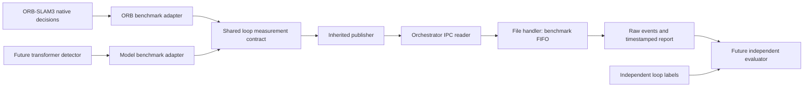

# Loop measurements for baseline/model comparison

The concrete benchmark publishes measurements through inherited
`Benchmark.publish_loop_measurement()`. The shared contract lives in
`evaluation/src/benchmarks/loop_events.py`; ORB-SLAM3 uses its native event callback
to publish that same format. The future transformer adapter must use this interface.

## Event types

| Event | Meaning |
|---|---|
| `keyframe_created` | A keyframe and its source stereo images, for replay. |
| `loop_query` | Every dequeued detection query, including queries with no candidates. Includes the original eligibility gate and reason. |
| `loop_proposed` | One same-map candidate verification attempt. |
| `loop_verified` | That attempt's geometric result, measured duration, and projection count when available. |
| `loop_decision` | Final native loop decision after confirmation and inertial checks. `accepted` reflects the native gate. |
| `constraint_inserted` | The existing correction path actually added both loop edges. |
| `map_merge_proposed`, `map_merge_verified`, `map_merge` | Cross-map measurements; kept separate from loop counters. |
| `timing` | Named tracking/place-recognition operation and elapsed seconds. |

Geometric acceptance can precede final confirmation. A final accepted decision
can precede constraint insertion. Preserve each stage rather than assigning them
the same meaning.

## Shared identities and payload

The IPC envelope includes run ID, benchmark ID, sequence ID, event number, and
integer dataset timestamp. Each loop measurement adds `loop_contract_version: 1`
and `detector_id`; the ORB baseline is `orb_slam3_dbow2`.

Every pair contains:

- Query/historical keyframe IDs, frame IDs, and map IDs for native traceability.
- Query/historical **original integer camera timestamps**.
- Query/historical stereo image paths relative to the sequence directory.
- `pair_id`, formed from both source timestamps. Join comparisons using
  `(sequence_id, query_timestamp_ns, historical_timestamp_ns)`; benchmark identity
  remains separate so baseline and model measurements can be matched.
- `attempt_id` and `stage` for proposals/results. Repeated attempts remain distinct;
  they are not counts of independent physical revisits.
- `accepted` for verification/final decisions. This is a detector/geometry result,
  not a ground-truth label.
- `verification_seconds` and nullable `projection_matches` for verification events.
  `null` means that projection stage was not reached/measured, rather than zero matches.

The native bridge rejects unmatched results, changed pair identities within an
attempt, missing timestamps, and incompatible instrumentation. Instrumentation
version 6 is required; the outer IPC protocol remains version 1.

## Comparison protocol

Replay the baseline's recorded keyframe/query stream into the transformer detector
to compare detection on the same images and sequence. Freeze query eligibility,
temporal exclusions, historical-image availability, and the development/test split
before measuring improvements. Independent SLAM runs can produce different
keyframes/maps after corrections; report those separately as integration experiments.

Keep no-candidate queries so missed opportunities can be evaluated once labels
exist. The future evaluator labels both detectors against the same independent
reference, groups repeated attempts using a declared revisit policy, and computes
TP/FP/FN, precision/recall, and timings by stage. ORB decisions must not serve as
the transformer's ground truth.

The report currently summarizes query/eligible-query counts, proposals, geometric
acceptances/rejections, final loop decisions/detected loops, and inserted constraints.
TP/FP/FN remain unavailable until that independent evaluator is implemented.

## Validation state

Native instrumentation is rebuilt with these hooks. Fixtures validate the contract,
integer timestamp preservation, failed/accepted attempts, final decisions, and FIFO
report counts. The C++ logger is tested directly against isolated keyframe identities.
These tests validate publishing, not detection accuracy or a completed sequence run.
Debug evaluation output directories remain empty as requested by the user.
