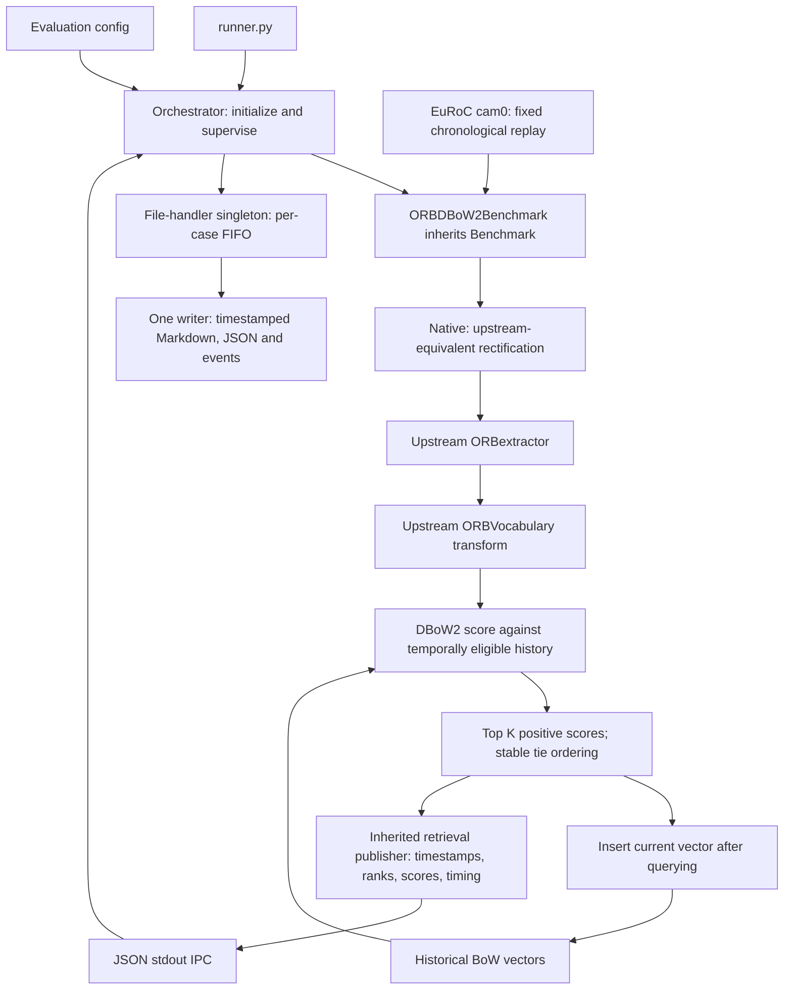

# Standalone ORB + DBoW2 evaluation topology

Status: implemented as the active retrieval baseline. Transformer selection,
independent labels and detection accuracy scoring remain pending. An independent
[candidate evidence checker](independent-candidate-evaluation.md) now reviews all returned pairs after native retrieval, using stereo XYZ reconstruction and reference-world consistency as the primary evidence.

## Boundary

This is an image-retrieval baseline built from the same ORB and DBoW2 code used
by ORB-SLAM3. Full-SLAM keyframe selection, covisibility aggregation, local map
exclusions, geometry, pose estimation and correction are outside this run.
It must not be named the full ORB-SLAM3 detector.

## Deterministic input/output contract

Input: cam0 image path and integer nanosecond timestamp. Defaults: 2 Hz uniform
time-grid sampling, 20 seconds of exclusion, top 5. No future-image access;
query before insert. No IMU processing or neural component in this baseline.

Output event `retrieval_query`: query timestamp, eligible history count,
feature count, BoW word count, stage timings in milliseconds, and ranked
historical timestamps with DBoW2 similarity scores. Zero-score pairs are not
returned. Tied positive scores prefer the oldest timestamp.

`Benchmark.publish_retrieval` validates and publishes the shared contract.
Future detector adapters can inherit this method and lifecycle. They must use
the same replay and history eligibility for comparable measurements; detector
specific feature metadata can be adapted when selecting the transformer.

## Measurements

The file handler summarizes sampled queries, queries with eligible history,
returned candidate records, empty eligible results, featureless images and
per-stage timing. Candidate counts are not accepted loops. Independent loop
labels are required for TP, FP, FN, precision and recall.

The native build manifest pins source revision, source/input hashes and linked
runtime dependencies. A separate oracle compares pixels, descriptors, BoW
vectors and pair scores to actual upstream Frame methods. Native output must
cover the entire replay in order and obey the exclusion/ranking policy.

## Files

- `evaluation/src/benchmarks/orb_dbow2/adapter.py`: preflight, replay, native child, measurements, cleanup.
- `evaluation/src/benchmarks/orb_dbow2/replay.py`: deterministic image selection.
- `evaluation/src/benchmarks/orb_dbow2/native/main.cc`: standalone extraction and historical scoring.
- `evaluation/src/benchmarks/orb_dbow2/build.py` and `verify.py`: build provenance and reference check.
- `evaluation/src/benchmarks/retrieval.py`: shared measurement validation.
- `evaluation/src/modules/evaluation_file_handler/`: FIFO owner and report writer.

Reports are generated under `evaluation/output/`; native traces, replay and
provenance are retained under `evaluation/output/native/orb_dbow2/<run-id>/`.
The former full-SLAM benchmark and its retained reports remain available.
