# ORB-SLAM3 benchmark code topology

Status: the ORB-SLAM3 adapter and native installation are implemented. Retained MH_01_easy runs process all 3,682 frames, save trajectories, and report native loop decisions. Instrumentation version 6 includes solver internals, candidate selection, local-map exclusions and candidate-count consistency checks. The adapter performs an optional post-run historical image validation; the handler includes source images and diagnostics in JSON and Markdown. All 25 tests passed in WSL. Independent loop accuracy remains unmeasured. See [loop measurement contract](loop-events-contract.md) and [diagnostic topology](orb-slam3-diagnostic-topology.md).

The shared abstract `Benchmark` class exists in `evaluation/src/benchmarks/base.py`. `ORBSLAM3Benchmark` inherits its lifecycle and publishing interface, including `publish_loop_measurement()`. Its native callback validates comparison measurements before using the inherited publisher. The adapter entry point calls `raise SystemExit(benchmark.run())`. See [benchmark inheritance](benchmark-inheritance.md).

## First runnable case

Run the original ORB-SLAM3 detector in stereo–IMU mode on the complete EuRoC `MH_01_easy` sequence. Use the official EuRoC calibration and record the exact upstream revision, build configuration, and input timestamps. Disable the interactive viewer for automated execution.

Start with one sequence to validate integration. It is a development case, not a claim of held-out detection performance. Expand to the frozen benchmark split after instrumentation is verified.

Official implementation references:

- [ORB-SLAM3 repository](https://github.com/UZ-SLAMLab/ORB_SLAM3)
- [Stereo–inertial EuRoC executable](https://github.com/UZ-SLAMLab/ORB_SLAM3/blob/master/Examples/Stereo-Inertial/stereo_inertial_euroc.cc)
- [Loop-closing implementation](https://github.com/UZ-SLAMLab/ORB_SLAM3/blob/master/src/LoopClosing.cc)

## Process and information flow

```mermaid
flowchart TD
    RUN[runner.py] --> ORCH[Orchestrator]
    CFG[Global evaluation config] --> ORCH
    ORCH -->|Start and supervise| ADAPTER[ORB-SLAM3 Python adapter process]
    SETTINGS[ORB-specific config and pinned build] --> ADAPTER
    DATA[EuRoC camera and IMU files] --> INPUT[Prepare synchronized timestamp input]
    ADAPTER --> INPUT
    INPUT --> NATIVE[Native ORB-SLAM3 stereo–IMU executable]
    ADAPTER -->|Invoke and await| NATIVE
    NATIVE --> TRACE[Private native event trace and trajectories]
    TRACE --> BRIDGE[Adapter event bridge]
    BRIDGE --> PUB[BenchmarkPublisher]
    PUB -->|Stdout JSON IPC| ORCH
    NATIVE -->|Diagnostic output| LOGS[Adapter forwards diagnostics to stderr]
    LOGS --> ORCH
    ORCH --> FIFO[EvaluationFileHandler singleton: this case's FIFO]
    FIFO --> WRITE[Single shared-output writer]
    WRITE --> REPORT[Timestamped report and events.jsonl]
```



The orchestrator owns process supervision, deadlines, cancellation, and final case status. The adapter owns translation between ORB-SLAM3's native data and our common event protocol. The file handler owns the shared report and FIFO writing. The adapter must await native children and forward failure before exiting.

Native trajectories and the native instrumentation trace are private benchmark artifacts. They do not write to the shared evaluation report. The instrumentation writes a dedicated trace rather than mixing JSON with existing native stdout diagnostics. The adapter forwards trace events through the existing publisher.

## Implemented code layout

```text
evaluation/src/benchmarks/
  __init__.py
  orb_slam3/
    __init__.py
    __main__.py              # Minimal adapter entry point
    adapter.py               # Benchmark subclass: setup/execute/cleanup
    euroc_input.py           # Validate streams and prepare matched stereo timestamps
    native_session.py        # Invoke native binary, read trace, forward logs, collect artifacts
    config.yaml              # Native paths, sequence, sensor settings, headless mode
    upstream.lock.json       # Exact source revision and patch/build provenance
    instrumentation/
      EvaluationEvents.h     # Native instrumentation interface
      EvaluationEvents.cc    # Synchronized logger and attempt/timing scopes
    setup/
      build.py               # Pinned download, checksums, build, provenance
      patch_source.py        # Checked instrumentation and compatibility edits
      stage_euroc.py         # Verify/stage selected installed sequences in Linux
      README.md              # Setup and precise measurement definitions
```

The native checkout defaults to `/opt/loop-detector/ORB_SLAM3` in WSL. Builds occur separately from timed runs. Generated `evaluation-instrumentation.patch` and `evaluation-compatibility.patch` are preserved in that checkout; their hashes are recorded in `evaluation-build.json`. The source revision and source archive checksums are pinned in `upstream.lock.json`. Runtime logs/traces stay on Linux under `/opt/loop-detector/runs/orb_slam3`; finished artifacts are exported to `evaluation/output/native/orb_slam3`. This avoids errors when concurrently reading a live trace through the OneDrive/WSL mount.

## Module interfaces

| Module | Interface | Implementation responsibility |
|---|---|---|
| Adapter subclass | `execute()` plus optional `setup()` / `cleanup()` | ORB-specific input/session work. Lifecycle events and event publishing are inherited from `Benchmark`. |
| EuRoC input | `prepare(sequence_path, workspace)` | Validate calibration and IMU coverage, preserve integer timestamps, construct shared stereo frame input, return paths and counts. |
| Native session | `execute(inputs, native_config, on_event, on_log)` | Run the binary, read complete trace records, forward diagnostics, await termination, return trajectory paths and exit status. |
| Publisher | Existing `publish(...)` | Wrap real native events with run/process identity and event order for parent IPC. |

The session's event callback is the seam for native instrumentation. Its callers do not need to know whether the trace is read live or drained at exit. At completion, every complete trace record must have been forwarded exactly once. A malformed or truncated record causes an explicit failure.

## Native instrumentation contract

Add logging at the actual native decision points; keep the original detector and correction algorithms intact.

| Event | Native measurement |
|---|---|
| `instrumentation_ready` | Native revision, instrumentation version, sensor mode, and trace schema. Required handshake. |
| `keyframe_created` | Keyframe/frame ID, map ID, and original input timestamp association. |
| `loop_proposed` | A candidate selected for geometric loop verification, with query and historical keyframe/map identities. |
| `loop_verified` | Result of the same attempt. BoW acceptance means its optimized projection threshold passed; refinement acceptance means the existing refinement method returned true. Further covisibility and inertial gates still decide whether to correct. |
| `constraint_inserted` | Accepted loop actually committed to the existing correction path. |
| `map_merge` | Cross-map association/merge, recorded separately from a same-map loop. |
| `timing` | Named native operation and monotonic elapsed duration. |

Fix and document the precise meaning of candidate selection before counting proposals. Native retrieval candidates can also be logged, but must be distinguishable from proposals submitted for geometric verification. Repeated verification attempts need identities so the evaluator can group them rather than inflate revisit counts.

The implemented BoW proposal starts after invalid/neighbor candidates are excluded, before correspondence matching and geometry. Temporal refinement proposals are separate attempts with `stage: temporal_refinement`; BoW attempts use `stage: bow_geometry`. Both carry an `attempt_id`, query/historical keyframe IDs and map IDs. Every proposal must have exactly one result before `native_finished`. Cross-map attempts use `map_merge_proposed` / `map_merge_verified` and do not inflate loop counters.

Each native record includes a trace event number and any relevant keyframe IDs, map IDs, dataset timestamp, and measurement payload. Native logging uses synchronization because ORB-SLAM3 runs several threads. Preserve source timestamp associations instead of reconstructing nanoseconds by multiplying a floating-point timestamp.

The adapter requires the instrumentation handshake. An uninstrumented executable is an unsupported run, not a successful run with zero detections. Verification acceptance alone is not independent evidence that a proposal is a true positive.

## Configuration split

The global config chooses the adapter command, its process ID, timeout, and output policy:

```yaml
benchmarks:
  - id: orb_slam3_original_mh01
    command:
      - "{python}"
      - "-m"
      - benchmarks.orb_slam3
      - --config
      - evaluation/src/benchmarks/orb_slam3/config.yaml
    cwd: .
    timeout_seconds: 900
```

The ORB-specific config supplies the built binary, vocabulary, official settings, sequence name, build manifest, and a private per-run workspace. Each invocation creates a unique workspace. The adapter checks the manifest's pinned revision and binary/library/vocabulary/settings hashes before execution.

One initial benchmark process handles one sequence/variant. Additional sequences and variants should be separate configured cases with unique IDs, each using the existing dedicated FIFO.

## Runtime environment

WSL Ubuntu 24.04 is available on this computer. Prefer running the complete evaluation pipeline in WSL for native ORB-SLAM3 runs. Linux process groups can then cover both adapter and native children. A Windows Job Object around `wsl.exe` cannot be assumed to supervise processes inside the Linux VM.

Use a separate Linux Python environment; the current Windows `.venv` cannot be reused as a Linux interpreter environment. Access the existing project and EuRoC files through WSL without duplicating the 31 GB installation. Keep native build products on an appropriate Linux filesystem if mounted-filesystem performance becomes a problem.

Compatibility of the pinned native revision and dependencies with Ubuntu 24.04 must be verified during setup. Any required build-compatibility patches must be recorded separately from instrumentation.

## Implementation sequence

1. Pin the official source revision and establish a reproducible native build.
2. Run the original stereo–IMU EuRoC example headlessly to verify data/config compatibility.
3. Add the explicit native event logger and candidate/verification/insertion hooks.
4. Implement input preparation and the Python adapter/session/event bridge.
5. Verify native trace parsing and IPC with fixtures, including native failure and truncated traces.
6. Enable the first real case in global configuration and run `MH_01_easy` through the orchestrator.
7. Inspect the trace and report against the actual native decision points before expanding the dataset split.

Initial results will include real proposals, explicit acceptances, constraints, keyframes, timing, native exit state, and trajectory artifact paths. Independent TP/FP/FN and recall require the separate ground-truth evaluator.

## Running on this Windows workstation

From the project directory, run `uv run python evaluation/run_wsl.py`.
The launcher starts the entire existing runner/orchestrator/publisher/handler pipeline
with `/opt/loop-detector/python-env/bin/python` inside `Ubuntu-24.04`.
The minimal `evaluation/src/runner.py` remains unchanged.

Reports and exported native artifacts are written under `evaluation/output` in the
same Windows project. MH_01_easy is staged from its existing verified archive
into `/opt/loop-detector/datasets/euroc` to avoid OneDrive image-read latency.
The 11-sequence installation stays in the project; only this selected development
sequence is cached. The cache receipt records the archive SHA256 and CRC validation,
and the adapter compares it against source archive metadata before replay.
Inside WSL, use the installed
Linux interpreter to run `evaluation/src/runner.py` directly.

Native shutdown explicitly drains mapping/loop queues and waits for threads before
trajectory saving; that lifecycle adjustment is recorded as a compatibility patch.
Measured timings include instrumentation overhead. Native thread scheduling is not
controlled by the global Python seed.
