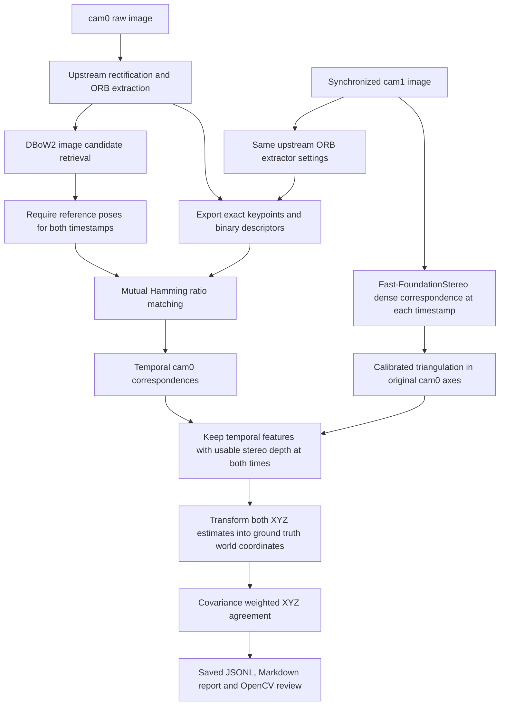

# ORB feature identity and XYZ evaluation

## Flow

## Responsibilities

- Native benchmark exports the exact cam0 ORB descriptors used by DBoW2,
  plus cam1 descriptors for historical comparison. Active stereo depth uses the
  configured Fast-FoundationStereo model. Retrieval performs no XYZ judgment.
- DBoW2 returns image pairs and rankings, not feature correspondences.
- Python matches exported descriptors using Hamming distance and the saved
  mutual ratio threshold. These are our ORB correspondences, not the full
  ORB-SLAM3 geometric acceptance pipeline or ORBmatcher implementation.
- Stereo/XYZ math is unchanged. Version 4 scales the required passing count
  as ceil(reported temporal ORB feature matches × minimum_inlier_ratio).
  Support ratio uses all reported matches before stereo filtering.
  Depth-valid agreement is reported separately; missing depth is not disagreement.
- Reference poses are required before pair evaluation. Missing depth produces
  insufficient evidence, not a false positive label.
- The viewer uses saved correspondences and saved XYZ evidence; it performs
  no feature extraction or reconstruction.

## Coordinates and identity

Extraction occurs on the benchmark's rectified images. Each keypoint is mapped
back to original raw sensor pixels by bilinear sampling of the actual
rectification maps. Triangulation uses raw EuRoC intrinsics, distortion and
body-to-camera extrinsics. Rectified coordinates must not be combined with
raw camera extrinsics.

Feature identity is `(timestamp_ns, camera, descriptor_row_index)`.
`query_feature_id` and `historical_feature_id` refer to the exported cam0 rows.
Matching gates may remove features, but indices are never renumbered.

Binary export `LDORB001`: 8-byte magic, three little-endian uint32 values
(count, width, height), then 56 bytes per feature: five float32 values
(rectified x/y, raw x/y, angle), int32 octave, and 32 ORB descriptor bytes.
`manifest.json` binds every export to SHA-256 hashes of its bytes and the source
image. Evaluator provenance hashes exports, manifest, input trace and code.
Missing or modified exports fail explicitly; no alternative extractor runs.

## Verification and interpretation

The build verifies cam0 and cam1 feature export bytes against actual upstream
`Frame::ExtractORB`. Existing pixel, descriptor, BoW and score parity checks
remain required. Synthetic unit fixtures use OpenCV ORB solely to exercise the
export reader, matching and geometry without requiring a Linux native build.

Sharing the detector's feature representation reduces evaluator independence.
Ground truth poses still provide external geometric evidence, but ORB matching
can miss valid overlap. Insufficient evidence is not a definitive false
negative. Neither this checker nor retrieval-only runs measure recall without
an independently labeled set of positive and negative image pairs.

See `dense-stereo-evaluation.md` for the version 5 pretrained stereo backend.
