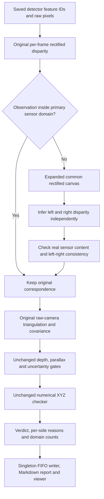

# Stereo coverage investigation and implemented correction

Date: 2026-10-04. Configuration: LDO-MegaLoc-LightGlue versus the existing ORB + DBoW2 baseline on EuRoC MH_01_easy, 2 Hz. Scope: offline evaluation of frozen candidate pairs and reported feature assignments.

## Findings and result

The original aggregate coverage comparison was incomplete. LDO proposes features across the raw image. The native ORB adapter rectifies images before extraction and therefore does not propose features in much of the peripheral raw field. Our evaluator's primary rectification cropped those additional LDO observations out. That preparation defect was being reported as invalid disparity.

A second, larger limitation is depth precision: under the saved 11 cm baseline, assumed 1 px pixel noise and depth gates, distant features can be good visual matches while remaining unsuitable for a two-depth XYZ comparison. These abstentions are not evidence that the detector is wrong.

Implemented: retain the original stereo path, recover only cropped observations with separately masked full-field inference, keep numerical XYZ and depth thresholds unchanged, and report coverage/failure reasons by domain. All matches remain in the total denominator.

| LDO feature observations | Original | Corrected |
| --- | ---: | ---: |
| XYZ-supported | 169,337 | 186,611 |
| XYZ-contradicted | 5,365 | 6,224 |
| Untestable | 279,128 | 260,995 |
| Total reported | 453,830 | 453,830 |
| XYZ evaluation coverage | 38.50% | 42.49% |

**18,133 previously untestable observations became judgeable: 17,274 supported and 859 contradicted.** The original 174,702 judgeable observations retained exactly the same feature IDs, pixel coordinates, verdicts, world positions, combined covariance and numerical XYZ scores.

ORB retains 22,309 supported, 2,286 contradicted and 30,107 untestable observations. The final comparison uses each detector's own original primary disparity cache.

## 1. What caused the original abstentions?

All 279,128 original LDO abstentions have `reliable_stereo_depth_unavailable`. Both poses were available for admitted pairs; missing reference poses were excluded before evaluation.

| At least one side has this failure | LDO correspondence observations |
| --- | ---: |
| Uncertain stereo depth | 107,006 |
| Low stereo parallax | 99,462 |
| Invalid disparity / cropped observation | 75,205 |
| Left/right inconsistency | 53,496 |
| Occlusion or outside image | 10,840 |
| Depth outside allowed range | 922 |

**These incidences overlap:** one match can fail differently in its two observations. The union involving low parallax or excessive depth uncertainty is 177,229 matches, 63.49% of all original abstentions. The detailed report's joint query/history rows are exclusive and sum to the untestable count.

Original missing-depth sides: 178,544 both, 52,462 query only, 48,122 history only. A temporal left-image match needs usable synchronized stereo evidence at both timestamps; one successful depth estimate does not satisfy the unchanged XYZ contract.

A 37-frame audit of original dense stereo found 5,946 invalid/cropped local observations; all 5,946 were outside the primary rectified canvas. This is an observation-level sample, not a population-wide depth-accuracy claim.

## 2. Why the camera geometry matters

Near the optical axis:

```text
Z = f B / d
sigma_Z / Z approximately sigma_d / d
sigma_d approximately sqrt(2) * sigma_pixel   (independent pixel-noise approximation)
```

Our EuRoC calibration has baseline 0.11008 m and cam0 focal length about 458.65 px. At 10 m, disparity is about 5 px, so the 1 px noise assumption implies roughly 28% relative depth uncertainty. The 25% gate has a nominal on-axis depth limit near **8.93 m**. The 0.5 degree parallax gate also excludes sufficiently distant rays; geometry away from the optical axis changes these limits.

Measured stereo estimates in the 37-frame sample:

| Reconstruction group | Observations | Median estimated depth | Median relative depth sigma |
| --- | ---: | ---: | ---: |
| Reliable | 19,593 | 4.66 m | 15.40% |
| Uncertain depth | 3,718 | 8.61 m | 29.27% |
| Low parallax | 3,367 | 12.13 m | 43.06% |

These depths come from the stereo model, not independent ground-truth landmark depth. The pixel/pose noise model is assumed, not empirically calibrated model confidence. The benchmark supplies reference poses; those poses alone do not establish a feature's true depth.

Relaxing gates or reducing assumed noise solely to increase coverage would change what the verdict means. Larger uncertainty can hide wrong correspondences inside a permissive XYZ ellipsoid; smaller assumed uncertainty can create false confidence.

## 3. Correct the comparison's image-domain interpretation

| Domain | LDO reported | LDO judgeable | LDO coverage | ORB coverage |
| --- | ---: | ---: | ---: | ---: |
| Both observations within primary rectified domain | 378,625 | 174,702 | **46.14%** | **44.96%** |
| At least one observation in additional raw field | 75,205 | 18,133 | **24.11%** | No reported observations |
| Entire reported set | 453,830 | 192,835 | **42.49%** | **44.96%** |

The original LDO primary-domain coverage was already 46.14%; the correction recovers additional peripheral evidence. Aggregate 38.50% versus 44.96% therefore did not establish poorer LDO matching quality.

Domain stratification improves interpretation but does not equalize candidate image pairs, feature budgets, depth distributions or model preprocessing. These counts remain repeated feature observations, not distinct world landmarks or detected loop closures. They do not establish precision/recall.

## 4. Implemented topology



The expanded EuRoC canvas is **1006 x 656**, versus the primary **752 x 480**. A common translation of both projection matrices preserves focal/disparity scale and horizontal epipolar geometry. Both maps carry explicit valid-sensor masks; black padding cannot become evidence. Right-image coordinates are bounded against the original sensor size, not the expanded canvas.

Recovery eligibility depends only on an observation's primary-domain location. It does not depend on a temporal match, reference pose, retrieval score or whether XYZ would pass. Left/right consistency, raw triangulation, depth range, parallax, relative depth uncertainty and final Mahalanobis thresholds are unchanged.

### Rejected ablation

Replacing the entire primary canvas with full-field inference changed central predictions substantially. In the two-frame probe, reliable depths changed from 361 to 226 for the query, and 524 to 598 for history. The model is not invariant to a changed input canvas. The implemented recovery retains original primary results and uses the expanded field only where primary evidence was absent.

### Cache audit

Nominally identical frames can have independently saved disparities that differ slightly across GPU runs. A preliminary shared-cache ORB replay retained every verdict but changed some numerical scores. The final frozen comparison uses **case-specific original primary caches** and separately fingerprints recovered disparity. Cached inference is verified by model/worker, policy, calibration and per-frame input/output hashes.

## 5. Code and accounting

- `candidate_evaluator/rectification.py`: calibrated primary/expanded layouts and sensor-content masks.
- `candidate_evaluator/dense_stereo.py`: persistent worker, original primary cache, independent cropped-observation recovery and provenance.
- `candidate_evaluator/coverage.py`: exclusive failure pairs, side counts and domain verdict accounting.
- `candidate_evaluator/coverage_analysis.py`: streaming completed-evidence audit, evidence checksum and unique timestamp/feature observation counts.
- `candidate_evaluator/stereo.py`: connects preparation and bounded reason/domain records to the unchanged numerical calculation.
- `evaluation_file_handler`: validates per-pair and final breakdowns before publishing JSON/Markdown through the existing FIFO writer.
- `candidate_viewer/depth_explanation.py`: shows relevant threshold and saved recovery source; unknown remains cyan.

Numerical policy stays version 8; stereo preparation is explicitly version 2. `xyz.py` and evaluator `config.yaml` retain their historical hashes. AST regression checks preserve the numerical projection, triangulation, reconstruction/covariance and landmark comparison functions.

No temporal RANSAC, grid coverage filter, new loop acceptance, transformer training or reference-pose input to the detector was introduced.

## 6. Verification and cost

- **87 tests passed**, including 19 subtests.
- Ruff lint/format checks pass on the added and modified evaluator/report modules.
- Full 2 Hz replay: **1,512 admitted LDO pairs** and **1,540 admitted ORB pairs**; original candidate lists and match assignments preserved.
- Exact original LDO numerical preservation: **174,702 / 174,702** judgeable observations.
- Exact ORB preservation is recorded in the attached transition ledger.
- Real pretrained GPU recovery and Windows viewer exports verified.
- Final dated reports are generated by the existing singleton file handler; its FIFO reconciliation checks the new domain and failure totals.

First corrected LDO offline replay: **1091.81 s**, with primary disparity cached and full-field disparity inferred. Final cached LDO replay: **385.71 s**. Final case-specific cached ORB replay: **217.64 s**. These are offline evaluator durations, not transformer inference timings or a controlled runtime comparison. Recovery adds a second stereo pass only for frames needing additional field coverage. The default LDO benchmark allows 2,700 s to include that pass.

## 7. Further coverage should come from independent evidence

The remaining abstentions should not be converted into false matches or automatic support. The strongest further improvement would be independent, registered reference depth and an empirically calibrated uncertainty model. A separately reported one-depth 3D-to-2D or bearing/epipolar check could judge some geometric constraints without claiming two independently established XYZ locations. Such evidence must remain distinct from the current XYZ-supported count.

Do not triangulate the alleged temporal loop correspondence and then use that same construction to certify itself. A local multi-view depth extension would need independent tracks, a sufficient baseline, modeled pose/depth correlations and separate validation.

## 8. Open the corrected feature viewer

From the project directory on Windows:

```powershell
uv run python evaluation/view_suspicious.py --checks "C:\Users\elayb\OneDrive\Documents\visual–IMU loop detector\evaluation\output\native\ldo\coverage_2026-10-04_00-09-15_36271dad_final\candidate_checks" --group untestable
```

The default viewer now selects the latest completed report, which lists LDO first. Use the supported/contradicted/untestable buttons and Copy flow to inspect individual evidence.

Analyze a completed result in WSL from `evaluation/src`:

```bash
/opt/loop-detector/ldo-env/bin/python -m tasks.feature_matching.xyz.coverage_analysis \
  --checks ../output/native/ldo/coverage_2026-10-04_00-09-15_36271dad_final/candidate_checks \
  --output /path/to/new-profile.json
```

## Primary sources

OpenCV documents that alpha=0 zooms/crops to valid output pixels, while retaining all original pixels changes the output field and can require a larger canvas. Our expanded layout preserves the primary projection scale rather than reducing it. [OpenCV stereoRectify documentation](https://docs.opencv.org/4.13.0/d9/d0c/group__calib3d.html).

The pinned pretrained stereo model expects rectified, undistorted stereo images. Its output remains an estimated disparity map, not ground-truth depth. [Official NVIDIA Fast-FoundationStereo repository](https://github.com/NVlabs/Fast-FoundationStereo).
