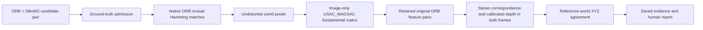

# Temporal RANSAC before XYZ

Current implementation: policy version 8 evaluates individual ORB correspondences without temporal RANSAC. See [feature XYZ evaluation](feature-xyz-evaluation.md). The earlier workflow below is retained as historical documentation.

## Data flow

RANSAC uses no ground truth, stereo depth or detector scores. Ground truth admits pairs and supports the subsequent independent XYZ comparison. RANSAC estimates image epipolar consistency; it does not prove a loop closure or identical physical landmark.

## Policy version 7

- Fundamental matrix: OpenCV USAC_MAGSAC, 3 px threshold on undistorted pixel coordinates, confidence 0.999, at most 10,000 iterations, saved seed.
- At least eight temporal matches are required to fit. Smaller sets retain their original matches and explicitly report `skipped_too_few_matches`.
- Failed/invalid fits or fewer than eight consensus matches retain zero matches and report `model_failed`; XYZ has insufficient evidence.
- Successful fits send only inlier DMatch objects to stereo/XYZ, preserving the original query and historical ORB row IDs.
- XYZ support requires ceil(retained_count * support_ratio) passing matches. No cell/grid-coverage gate is applied. Missing stereo depth is not a geometric contradiction.
- Raw count, retained count, discarded feature IDs, inlier mask, matrix and fit policy are saved in pairs.jsonl. Summaries reconcile the raw/retained/discarded totals.
- The viewer shows a dedicated RANSAC stage. The overlay shows only retained post-RANSAC matches, with all lines visible by default; missing depth is shown as untested. Line colors remain the existing XYZ/reprojection evidence colors; discarded matches do not receive a false XYZ-failure color.

## Verified stereo cache reuse

`LDO_STEREO_CACHE_SOURCE` optionally names a previous completed native run's stereo_correspondences directory. Its adjacent candidate_checks/provenance.json must match current non-RANSAC policy, worker, model and install manifest. Each cached disparity requires its original policy/calibration signature, matching left/right image hashes and matching disparity hash. Verified maps are copied into the new run and the source is recorded. Other frames run inference normally. Original cache files are not modified.

This accelerates rerunning the checker; it does not reuse previous RANSAC or XYZ decisions. Near-pure rotation, planar scenes and repeated textures can make a fundamental-matrix fit ambiguous; the independent XYZ check remains necessary. Thresholds are provisional.
