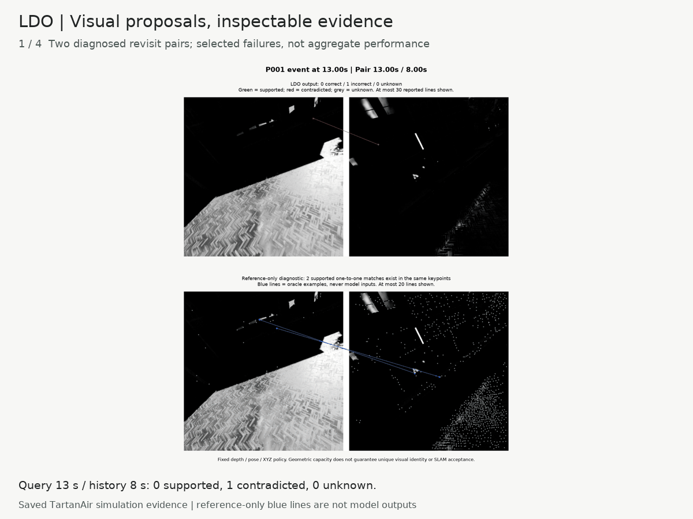
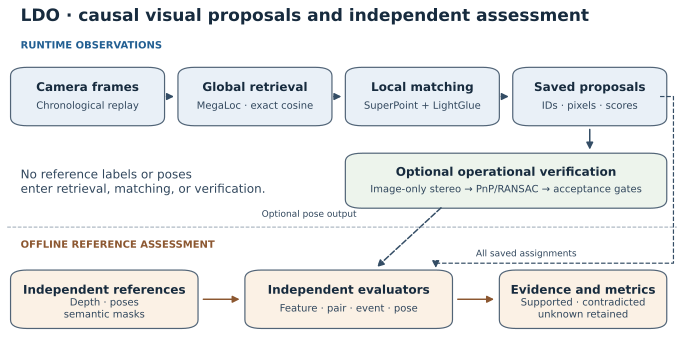

# LDO: Causal Visual Loop Detection

**Visual proposals, explicit geometric evidence, and independent evaluation.**

Research software by **Elay Barnoam** · Python 3.11 · synthetic and saved-evidence studies

[](https://github.com/Elaybarnoam/LDO/actions/workflows/checks.yml)
[](https://github.com/Elaybarnoam/LDO/releases)
[](docs/licensing.md)

[Quickstart](#quickstart) · [Method](docs/method.md) ·
[Starter issues](https://github.com/Elaybarnoam/LDO/contribute) ·
[Questions](https://github.com/Elaybarnoam/LDO/discussions) · [Roadmap](docs/roadmap.md)

LDO is research software for **visual loop-closure detection** and **visual place
recognition**: it retrieves historical camera observations and reports the local
correspondences that support each proposal. Its current baseline combines frozen **MegaLoc** global
descriptors with **SuperPoint + LightGlue** local matching. Replaceable model
interfaces, causal replay, saved assignments, and independent reference assessment
make it possible to examine where retrieval, matching, and geometric verification
succeed or fail.

| Practical guides | Start here |
| --- | --- |
| Run visual loop detection with MegaLoc and LightGlue | [CPU check, learned-model prerequisites, and Python interface](docs/guides/visual-loop-detection.md) |
| Evaluate loop-closure correspondences | [Supported, contradicted, unknown, and independent geometry](docs/guides/evaluate-correspondences.md) |
| Reproduce LDO results | [Commands, expected values, and evidence checks](docs/guides/reproduce-results.md) |
| Understand a matching tradeoff | [Why higher precision can lose useful loop events](docs/guides/precision-and-event-retention.md) |



*Saved learned-model evidence from TartanAir simulation, selected to explain two
failure mechanisms. This is a presentation replay, without a trajectory or runtime
pose decision. [Reproduce it on CPU](examples/evidence_walkthrough/README.md);
[view the static poster](docs/assets/community/evidence-poster.png).*

The central research question is whether a proposal reaches a real revisit
opportunity, whether its assignments are supported by independent geometry, and
whether useful evidence survives model selection. LDO records these as separate
measurements and retains **unknown** evidence instead of assigning it a convenient label.

Current detectors consume camera images only. Optional image-only stereo/PnP
verification produces relative-pose proposals. IMU fusion and downstream SLAM
improvement are future research; the retained distribution name
`visual-imu-loop-detector` does not imply those capabilities.



*Runtime uses observations. Reference depth, poses, and semantics enter separate
offline evaluators. Direct feature evaluation includes original assignments and
does not select them using operational acceptance or fitted pose.*

## Problem formulation

Given chronological images $`I_q`$ with timestamps $`t_q`$, retrieve up to $`k`$
historical candidates and their reported correspondences. To exclude immediate
temporal neighbors, eligible history is

```math
\mathcal H_q=\{h\in\text{past frames}:t_h\le t_q-\Delta\}.
```

The detector queries before inserting the current frame. Candidate ranking,
correspondence correctness, independently labeled image-pair overlap, confirmed
event coverage, and accepted relative-pose constraints answer different questions.
An incorrect feature does not automatically make the entire place proposal false;
a geometrically accepted transform does not independently prove a correct loop.

## Method

**Global retrieval.** Unit-normalized descriptors are compared by exact cosine
similarity over eligible history:

```math
d_q=\frac{g(I_q)}{\|g(I_q)\|_2},\qquad
s(q,h)=d_q^\top d_h,\qquad
\mathcal C_q=\mathrm{Top}_k\{(h,s(q,h)):h\in\mathcal H_q\}.
```

Ties favor earlier timestamps. Representation fingerprints prevent mixing
descriptor spaces. Historical descriptor storage grows with trajectory length;
the bounded local-feature cache does not imply bounded total memory.

**Local matching.** Compatible extraction/matching adapters return original-camera
pixels and one-to-one sparse feature assignments with explicit score meanings.
The retained research baseline uses confidence 0.3 and 1,024 SuperPoint keypoints.
Pair-dependent image matchers use a separate pixel-correspondence interface.
Scores are not calibrated probabilities of loop correctness.

**Optional operational verification.** Reliable query stereo depth supplies metric
3D observations. Seeded EPnP/RANSAC, LM refinement, and count/residual/geometry
gates estimate $`\hat T_{hq}`$, mapping query-camera points into the historical
camera. Runtime verification receives no reference pose, loop label, or offline
feature verdict. It distinguishes accepted, rejected, and insufficient evidence.

**Independent assessment.** Reference depth and poses assess every saved reported
assignment using metric disagreement and symmetric reprojection. Independent
surface-overlap bounds label candidate pairs. Supported $`S`$, contradicted $`C`$,
and unknown $`U`$ assignments are reported together:

```math
P_{\mathrm{judged}}=\frac{S}{S+C},\qquad
\mathrm{Coverage}=\frac{S+C}{S+C+U},\qquad
P_{\mathrm{all}}\in\left[\frac{S}{S+C+U},\frac{S+U}{S+C+U}\right].
```

These bounds describe correctness under the reference policy, not confidence
intervals or calibrated physical truth. Unknown reference coverage withholds
overall-recall claims. See the [complete mathematical method](docs/method.md),
[notation](docs/notation.md), and [equation-to-code audit](docs/method.md#9-definition-to-code-audit).

## Experimental evidence

The matching-selection study used 880 shared Factory/Desert development pairs,
then tested the frozen choice on all three **OldTownFall** trajectories. The
table compares confidence 0.3 and 0.4 on the same LDO retrieval identities,
using depth-v2 feature assessment and the original independent pair/event policy.

<!-- BEGIN OLDTOWN_TABLE -->
| Measurement | Baseline LDO (0.3) | Experimental LDO (0.4) |
| --- | ---: | ---: |
| Supported assignments | 40,003 | 38,673 |
| Contradicted assignments | 100,983 | 83,526 |
| Unknown assignments | 9,879 | 8,457 |
| Correct among judgeable | 28.4% | 31.6% |
| Judgeable coverage | 93.5% | 93.5% |
| Raw confirmed event hits | 17/17 | 17/17 |
| Events with ≥20 supported matches | 13/17 | 12/17 |
<!-- END OLDTOWN_TABLE -->


*Confidence 0.4 removes 17.3% of contradicted assignments and retains 96.7% of
supported assignments, but loses one event under the external ≥20-supported-match
diagnostic. Keep confidence 0.3 when event retention is the priority; 0.4 remains
an experimental option. The diagnostic is not an accepted SLAM constraint.*

The original frozen Factory/Desert comparison reached **48/53 confirmed event
runs with LDO versus 42/53 with ORB + DBoW2**. Incomplete reference labels prevent
calling these overall recall. Factory/Desert subsequently became matching
development data; OldTownFall is now inspected. Neither dataset is advertised as
a fresh test for future choices.

The **EfficientLoFTR trial was not promoted**. On 320 identical validation pairs
it increased supported assignments and usable positive pairs, alongside more
contradicted assignments and lower judgeable coverage. Failed promotion rules,
all ablations, and original unknown accounting remain in the
[results guide](docs/results/README.md) and [experiment registry](results/index.json).
The component ORB + DBoW2 correspondence baseline is not the full ORB-SLAM3
acceptance pipeline.

### A failure case


*OldTownFall P001, query 13 s/history 8 s: zero supported and one contradicted
reported assignment. The reference-only diagnostic finds at most two supported
one-to-one associations among existing keypoints. Blue oracle lines are never
model inputs or recovered model outputs. This is the low-capacity case among
four diagnosed failed events; see [failure analysis](docs/results/README.md).*

## Quickstart

From a checkout, install the locked **Python 3.11** CPU environment:

```bash
uv sync --locked
uv run ldo-research doctor
uv run ldo-research smoke --output artifacts/smoke.json
uv run python -m pytest -q
```

The smoke example processes four synthetic frames through the production detector
interface without checkpoints, CUDA, data downloads, or native builds. Expected
eligible-history counts are `[0, 0, 1, 2]`; the final query returns frames `0`, `1`.
Its output explicitly marks `research_result: false`.

Learned inference and native benchmarks use a separately installed WSL/CUDA
profile. Windows supports CPU work, saved-evidence review, and forwarding through
the existing evaluation launchers. See [installation and profiles](docs/installation.md)
for model/native prerequisites, path overrides, and configuration precedence.

## Reproduce the evidence

Regenerate public tables and scientific figures from the tracked historical
summaries, without rerunning models:

```bash
uv sync --locked --extra visualization
uv run python scripts/reproduce/publish.py --output artifacts/reproduced-results --figures artifacts/reproduced-figures
uv run python scripts/figures/render_diagrams.py --output artifacts/reproduced-diagrams
uv run python scripts/check_repository.py
```

Each study manifest records source-summary hashes, protocol identity, evaluator,
and dataset role. Figure manifests record inputs/selection scope and generator/
output hashes. Source, policies, model/checkpoint identities, input order, original
assignments, and detailed verdicts remain part of the full experiment lineage.

Presentation reproduction differs from a scientific rerun. Bulk datasets,
checkpoints, and full per-match evidence remain external. The
[reproducibility guide](docs/reproducibility.md) explains saved-evidence rescoring,
fresh inference, expected totals, integrity checks, and historical replay. Full
workflows must satisfy the original study's requirements; changing source paths
does not justify rewriting old hashes or bypassing cache validation.

## Repository structure

```text
src/ldo/                    Causal detector, adapters, contracts, and evidence
src/loop_verification/      Observation-only metric relative-pose verification
src/stereo_observations/    Calibrated image-only stereo and reconstruction
src/loop_eval/              Benchmarks, independent evaluators, and infrastructure
configs/                    Models, operational policies, evaluation, and runtime
tests/                      Unit, integration, and scientific regression suites
scripts/                    Evidence curation, figures, and repository checks
examples/                   Minimal CPU replay
docs/                       Method, protocols, results, assets, and historical record
results/                    Compact study manifests and generated metrics/tables
data/                       Acquisition notes and dataset metadata
evaluation/                 Compatibility launchers and ignored local evidence
```

Start with the [documentation index](docs/index.md) or [architecture](docs/architecture.md).
The [migration ledger](docs/decisions/migration-ledger.json) maps historical paths
and protects original evidence. New generated local outputs belong under ignored
`artifacts/` or an explicit external root.

## Limitations and next research

Current evidence is largely synthetic, with short early trajectories, incomplete
reference judgments, provisional operational thresholds, and unaudited pretrained
exposure. Reference event runs need not be independent physical revisits. More
reported matches can include more incorrect matches; higher judged precision can
coexist with lost useful events. No real-time, real-world superiority, long-term
generalization, inertial fusion, or downstream SLAM improvement is established.

Next studies should target association quality and low-overlap observations with
explicit per-event retention objectives, new development data, and an unexamined
test set. Inertial integration and corrective SLAM evaluation require separate
protocols. See [limitations](docs/limitations.md) and [current validation](docs/validation.md).

## Citation and acknowledgments

Authorship and software metadata are in [CITATION.cff](CITATION.cff). No publication,
institutional affiliation, or DOI is implied. Cite the upstream methods used by
your experiment: [MegaLoc](https://github.com/gmberton/MegaLoc),
[SuperPoint/LightGlue](https://github.com/cvg/LightGlue),
[ORB-SLAM3 and its ORB/DBoW2 dependencies](https://github.com/UZ-SLAMLab/ORB_SLAM3),
[EfficientLoFTR](https://github.com/zju3dv/EfficientLoFTR), and
[TartanAir data](https://huggingface.co/datasets/theairlabcmu/tartanair2), as applicable.
[Pinned revisions](src/ldo/upstream.lock.json) and [bibliography](docs/references.bib)
provide the source record.

Original project code is **Apache-2.0**, with the GPL instrumentation and third-party
exceptions documented in [licensing](docs/licensing.md) and [NOTICE](NOTICE).
Models, datasets and illustrative images retain their separate terms.

## Contribute

These three starter tasks need no GPU, checkpoints, or dataset download:

| Task | Starting point |
| --- | --- |
| Verify and document a clean Linux CPU installation | [Issue #1](https://github.com/Elaybarnoam/LDO/issues/1) |
| Make missing model-root errors actionable | [Issue #2](https://github.com/Elaybarnoam/LDO/issues/2) |
| Add text alternatives to correspondence review canvases | [Issue #3](https://github.com/Elaybarnoam/LDO/issues/3) |

Start with a [small CPU-only issue](https://github.com/Elaybarnoam/LDO/contribute),
report a reproducibility problem, or propose an evaluation in
[Discussions](https://github.com/Elaybarnoam/LDO/discussions). Current priorities
are clean Linux setup, actionable diagnostics, accessible evidence review, dataset
adapters and retrieval scaling. See [the roadmap](docs/roadmap.md) and
[contribution guide](CONTRIBUTING.md) for scope and validation commands.
