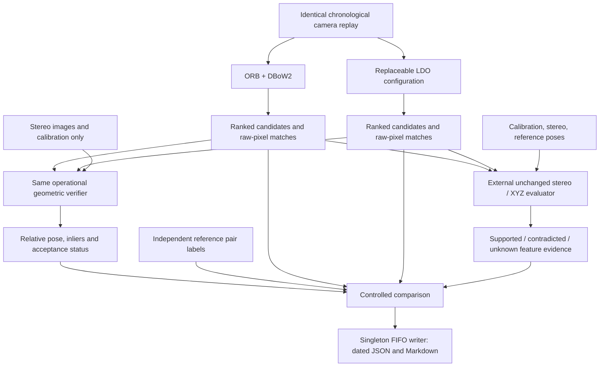

# LDO versus ORB validation plan

Updated: 2026-10-06. This is the overall protocol. Task-specific implementation plans are in `evaluation/src/tasks/feature_matching/PLAN.md` and `evaluation/src/tasks/loop_closure/PLAN.md`.

## Claim and limits

Hypothesis: LDO retrieves more genuine loop opportunities at comparable precision and provides better correspondences. Latency is separate. Feature observations are not unique landmarks or accepted SLAM constraints. Existing results on MH_01 are development evidence, not held-out proof.

## Topology



## Frozen protocol

Same frames, sampling, historical eligibility, temporal exclusion, query-before-insert and top K. Compare K=1 and K=5. Scores have different meanings; never compare their numerical thresholds directly. Evaluate at equal K first. Preserve original-image pixel coordinates and actual candidate rank. Missing reference poses exclude a pair from evaluation, never from causal detector history. Save all exclusions.

MH_01_easy is development. V1_01_easy and V2_01_easy are initial held-out sequences; additional difficult sequences and a separate dataset are subsequent validation. No threshold tuning on held-out results. Mark training-data overlap unknown unless audited; held-out sequences do not automatically establish out-of-distribution generalization for pretrained models.

## Independent reference set

Choose query timestamps deterministically before loading detector results. Enumerate ALL temporally eligible historical frames for each selected query with valid poses, including pairs missed by both systems. Pose distance and orientation are review aids, not truth labels. Use original images, calibrated geometry and independent scene evidence; manually annotate real loop / non-loop / unknown, with reviewer and justification. Repeat ambiguous reviews independently before claiming paper-grade labels. Define a loop as enough shared physical scene to make the pair useful for geometric verification; document the review rubric before annotation. Do not use either detector's correspondences or XYZ pass counts as reference labels.

The implementation exposes every admissible pair, including distant pairs. It never automatically labels distant poses negative or close poses positive. Unknown stays unknown. A query is reference-complete only when every admissible history pair has a decisive label. Recall and query-success point estimates require complete queries; partial references provide precision bounds, annotation coverage and diagnostic labeled-subset precision, never an unsupported recall claim.

## Three experiments

1. Retrieval: consume frozen detector traces on the same replay. Precision@K, pair recall@K and query success@K. Count known true/false/unknown outputs. For incomplete references provide precision lower/upper bounds. Report only reference-complete queries for recall, and their fraction. Compare discoveries by both, LDO only, ORB only, neither. No model-specific filtering/refilling after reference exclusions.
2. Matching: feed an independently chosen fixed reference pair set to both matchers, including zero-match pairs. ORB uses the existing pinned upstream ORB exports and existing mutual Hamming ratio matcher; this is ORB-feature matching, not native full-SLAM acceptance. LDO uses its configured pair engine. Evaluate via the identical external v8 stereo/XYZ evaluator. Normal feature budgets first; controlled extraction budgets require rerunning both extractors with an equal cap, not truncating verdicts after XYZ. A fixed correspondence output budget is a separate ablation, not an equal extraction budget.
3. Verified loop connections: apply the same operational relative-pose verifier to both detectors, then independently assess accepted connections using reference poses and loop labels. The verifier receives no ground truth. Compare correct accepted connections, incorrect accepted connections, unresolved outputs and missed known loop opportunities. Preserve the separate external XYZ feature evidence. The shared verifier and offline assessment are implemented. Reports distinguish operational acceptance from independently confirmed correctness; unknown labels remain unresolved.

## Statistics and acceptance

Per-sequence and equal-weight sequence aggregates. Report micro feature counts AND per-pair macro coverage/support/contradiction; include zero-match pairs. Use paired contiguous temporal-block bootstrap intervals for differences on complete-query retrieval metrics; do not bootstrap correlated individual features. A one-sequence interval is conditional evidence, not cross-sequence generalization. Equal-false-positive threshold sweeps require frozen development thresholds and enough independent labels; do not pick thresholds on test labels.

Support the claim only if recall/query success improve at comparable precision across held-out sequences, matching improvements persist on identical pairs, and differences survive uncertainty analysis. Do not automatically declare a winner from raw feature totals.

## Implementation and operation

The task directories are separated:

```text
evaluation/src/tasks/
├── feature_matching/
│   ├── PLAN.md
│   ├── xyz/                 # Existing external checker and its policy
│   └── viewer/              # Existing per-feature review
└── loop_closure/
    ├── PLAN.md
    ├── config.yaml          # Existing comparison protocol
    ├── comparison/          # Existing reference and comparison workflow
    └── verification.py      # Adapter to the shared verifier

loop_verification/           # Planned operational component, outside evaluation
```

The orchestrator, benchmark adapters, publisher and singleton report writer remain shared infrastructure. The operational verifier belongs outside evaluation because a future SLAM integration must be able to use it without reference data. The loop task will own its evaluation adapter and assessment of results. Detailed contracts, milestones and validation gates are defined in its dedicated plan.

`evaluation/src/tasks/loop_closure/comparison/` owns reference construction, annotation, trace validation, metrics and fixed-pair matching. `evaluation/compare.py` is a thin CLI. `evaluation/src/tasks/loop_closure/config.yaml` configures the protocol. The existing singleton file handler owns final reports; the comparison module submits one immutable result through its FIFO. Stereo/XYZ formulas and thresholds remain unchanged.

Commands: `prepare` builds the reference universe and a matching trace; `review` provides detector-blind side-by-side OpenCV annotation; `compare` validates traces and produces dated reports; `match` generates LDO assignments on the fixed pairs and invokes unchanged XYZ for both adapters. No automatic download or manual truth invention. Prepared references start unknown, so initial reports correctly withhold recall until annotation is complete.

## Validation gates

Test missing truths, unknown precision bounds, unreturned positives, nonhistorical/duplicate/rank-invalid candidates, different replay contents, incomplete query recall, identical-pair requirements, zero matches, source hashes and paired bootstrap reproducibility. Smoke-test with actual saved MH_01 traces and a small real fixed-pair comparison. Keep resulting diagnostic report visibly preliminary until labels exist.

## Implemented initial run

The reference universe contains 2,688 pairs across 18 pose-admitted selected queries on MH_01. Labels start unknown and require independent review. The real fixed-pair smoke comparison ran four hash-selected pairs with an equal requested extraction cap of 1,024, sharing stereo predictions between methods. This is a wiring check, not a performance conclusion.

The CLI supports prepare, review, compare, match, shared verify and equal-sequence aggregate. `verify --supervised` routes the operational benchmark through the existing orchestrator and FIFO writer. `match --feature-budget N` re-extracts both methods at the same requested cap; default matching uses their normal configurations. Windows forwards analysis and inference to WSL while OpenCV review stays native. See `evaluation/src/tasks/loop_closure/comparison/README.md` for commands and limitations.

Remaining scientific work: manually establish independent reference labels, run frozen held-out sequence configurations, audit pretrained training overlap, and evaluate frozen development operating points if claiming equal-precision gains. These require evidence that software cannot invent. Recall is intentionally unavailable until the relevant reference histories are completely labeled.

## Implementation and remaining evidence

1. Implemented typed shared verifier contracts and separate operational/stereo/assessment policies. Numerical defaults remain provisional.
2. Implemented observation-only stereo preparation and PnP/RANSAC refinement with accepted, rejected and insufficient-evidence states.
3. Implemented identical verification for ORB and LDO with per-assignment evidence and the existing process/event/report infrastructure.
4. Implemented offline reference-pose assessment and verified-loop metrics. Independently reviewed loop labels remain required for accuracy/recall.
5. Development synthetic, real smoke, fixed-pair and full MH_01 replay checks are run. Next: review independent labels, freeze development-selected settings, run held-out sequences and aggregate results.

Do not change XYZ thresholds to increase loop-verifier acceptance. Do not use evaluation labels, reference poses or XYZ verdicts to filter inputs to the operational verifier. Missing independent labels still withhold the affected accuracy metrics.

## Independent revisit-event protocol

The adopted interview decisions and full implementation are in `.docs/independent-revisit-evaluation-plan.md`. The new `revisits` task adds full-universe preparation, blind interval review, reviewer consensus, immutable snapshots, distinct-event metrics, development operating points and held-out controls. The initial MH_01 snapshot is explicitly unreviewed; pose proposals do not establish truth. See `evaluation/src/tasks/loop_closure/revisits/README.md` for commands.
