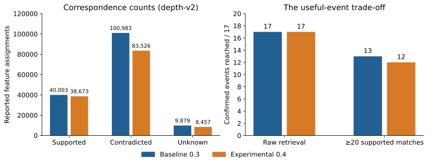
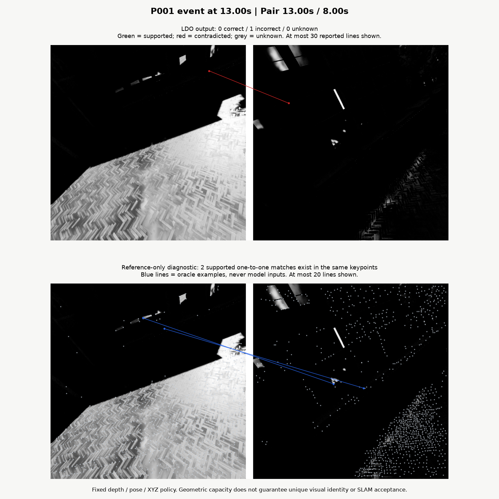

# Why higher matching precision can lose useful loop events

Filtering local matches more aggressively can improve a feature-level ratio while
removing evidence needed at a particular revisit. LDO's saved OldTownFall study
shows why visual loop-closure evaluation should retain event identities alongside
aggregate correspondence statistics.

## The recorded comparison

The frozen baseline uses MegaLoc retrieval, 1,024 SuperPoint keypoints and LightGlue
at confidence 0.3. The experimental variant uses confidence 0.4. The compared
retrieval identities and independent pair/event policy are unchanged. The
depth-v2 assessment counts supported, contradicted and unknown original assignments.

| Measurement | Confidence 0.3 | Confidence 0.4 |
| --- | ---: | ---: |
| Supported | 40,003 | 38,673 |
| Contradicted | 100,983 | 83,526 |
| Unknown | 9,879 | 8,457 |
| Precision among judgeable assignments | 28.4% | 31.6% |
| Judgeable coverage | 93.5% | 93.5% |
| Raw confirmed event hits | 17/17 | 17/17 |
| Events with at least 20 supported assignments | 13/17 | 12/17 |

Source: [tracked metrics](../../results/matching-oldtown/metrics.json),
[manifest and original evidence links](../../results/matching-oldtown/manifest.json).
This guide interprets an existing result; it introduces no experiment.

## Why the measurements diverge

Judged precision divides supported assignments by all judgeable assignments.
Here, confidence 0.4 removes about 17.3% of contradicted assignments while retaining
about 96.7% of supported assignments. That improves the ratio over all reported
features. It does not describe how retained support is distributed across events.

The useful-event diagnostic instead asks whether each independently confirmed
event retains a retrieved pair with at least 20 supported assignments. Losing
support at one marginal event can change that event's outcome even when aggregate
feature precision rises. A useful selection rule therefore needs both assignment
quality and event retention. Check exact event IDs before assuming counts alone
show that the same opportunities survived.



The 20-match threshold is an external diagnostic. It is not the runtime PnP gate,
an accepted SLAM constraint, or a proof that 20 matches suffice in every scene.
Both variants reaching 17/17 confirmed event runs does not establish overall recall
because reference labels are incomplete. Unknown assignments remain unknown.

## A failure worth inspecting



In this selected diagnosed pair, the baseline reports 0 supported, 1 contradicted
and 0 unknown assignments. The reference-only analysis finds a maximum capacity
of 2 supported one-to-one associations among the fixed keypoints. This illustrates
a low-capacity observation pair. It is not established as the particular event
lost by the 0.4 variant. Blue oracle associations are never recovered model outputs.
See [the archived diagnosis](../archive/ldo-matching-diagnostics-report.md).

## Reproduce and investigate

```bash
uv sync --locked --extra visualization
uv run python scripts/reproduce/publish.py --output artifacts/reproduced-results --figures artifacts/reproduced-figures
uv run python scripts/figures/render_community.py --output artifacts/community
uv run python scripts/check_repository.py
```

These commands use saved summaries and archived figures, with no GPU or model
downloads. Full per-event numerical replay requires the external raw evidence.
See [result reproduction](reproduce-results.md) for expected outputs.

Keep confidence 0.3 as the retained baseline; 0.4 remains experimental. Design the
next promotion protocol on new development data, retain baseline event identities,
and freeze settings before examining an uninspected test. The current simulated
and inspected studies do not establish real-world superiority or downstream SLAM
improvement.

For related work in this repository, start with
[accessible correspondence review (#3)](https://github.com/Elaybarnoam/LDO/issues/3),
[dataset adapters (#4)](https://github.com/Elaybarnoam/LDO/issues/4), or
[the evaluation guide](evaluate-correspondences.md).
