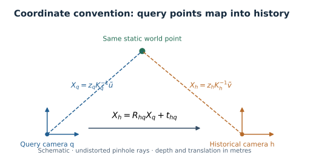

# Mathematical method and evaluation

This describes the implemented visual pipeline and its independent measurements.
Pretrained weights are frozen in the baseline. No end-to-end training objective or
inertial fusion is implied. Symbols and calibration conventions are defined in
the [notation reference](notation.md).

## 1. Causal candidate retrieval

At query time $`t_q`$, eligible history is

```math
\mathcal H_q=\{h\in\text{past frames}:t_h\le t_q-\Delta\}.
```

The cutoff includes equality. Eligibility is applied before ranking, and the
query is inserted only after its processing succeeds. For normalized global
descriptors,

```math
d_q=\frac{g(I_q)}{\|g(I_q)\|_2},\qquad
s(q,h)=d_q^\top d_h,\qquad
\mathcal C_q=\mathrm{Top}_k\{(h,s(q,h)):h\in\mathcal H_q\}.
```

`Top` returns ordered historical identifiers, sorting scores descending and
breaking ties by earlier timestamp. If fewer than $`k`$ frames are eligible, all
are returned. The current index uses exact cosine scores and full ordering;
it is not approximate-nearest-neighbor search. Descriptor fingerprints reject
incompatible model/preprocessing spaces.

For $`n`$ eligible descriptors of dimension $`d`$, similarity computation costs
$`O(nd)`$ and current full ordering costs $`O(n\log n)`$. Descriptor storage grows
with history. The bounded local-feature cache does not bound total detector memory.

## 2. Local observations and assignments

For sparse extraction,

```math
F_q=\{(u_i^q,d_i^q,\alpha_i^q)\}_{i=1}^{n_q},\qquad
\mathcal M_{qh}=\{(i,j,c_{ij})\}.
```

$`u_i^q`$ is an original-camera pixel, $`d_i^q`$ a local descriptor, $`\alpha_i^q`$
an extractor score, and $`c_{ij}`$ an adapter-defined matcher score. Each endpoint
appears at most once in sparse assignments. Extractor and matcher descriptor
families must be compatible. The current baseline uses MegaLoc global retrieval
and SuperPoint + LightGlue local matching; confidence 0.3 is the retained baseline.

Image-pair matchers instead return $`\{(u_i^q,v_i^h,c_i)\}`$, whose points can depend
on both images. The EfficientLoFTR trial uses this distinct interface and is not
promoted into the production detector registry. It cannot reuse sparse IDs by
pretending pair-dependent points are cached SuperPoint observations.

The threshold comparison and score definition belong to each adapter. Saved
evidence retains original assignments, scores, feature identities, and pixels;
offline reference verdicts do not filter runtime assignments.

## 3. Optional observation-only metric verification

Reliable query stereo depth provides metric query-camera points. In undistorted
pinhole notation,

```math
X_i^q=z_q(u_i^q)K_q^{-1}\tilde u_i^q.
```

The verifier estimates $`\hat T_{hq}`$ from query 3D points to historical 2D pixels.
Historical reprojection residuals are

```math
r_i(T)=\|\pi_h(TX_i^q)-v_i^h\|_2,
```

where $`\pi_h`$ is the calibrated projection including distortion. The
implementation uses seeded EPnP/RANSAC, LM refinement on selected inliers,
recomputed residuals/inliers, and deterministic acceptance gates. These include
usable-point count, inlier count/ratio, residual percentiles, cheirality, spatial
geometry, and Jacobian conditioning. Policies are explicit in the
[operational configuration](../configs/verification/config.yaml).

Depth is obtained from synchronized camera observations, never by triangulating
the alleged temporal correspondence or selecting a depth using a reference pose.
Missing depth remains unusable. Outputs distinguish accepted, rejected, and
insufficient evidence; invalid inputs raise an error. Acceptance is an operational
policy outcome and requires separate correctness assessment.



*Schematic camera convention. Rays use undistorted pinhole coordinates; runtime
projection uses the actual supplied camera model.*

## 4. Independent correspondence reference

Reference poses and depth enter only offline evaluation. For camera-to-world
poses, the reference query-to-history transform is

```math
T_{hq}^{\star}=(T_{Wh}^{\star})^{-1}T_{Wq}^{\star}.
```

For judgeable endpoint depths,

```math
X_q=z_q^{\star}(u)K_q^{-1}\tilde u,\qquad
X_h=z_h^{\star}(v)K_h^{-1}\tilde v.
```

The reference disagreement is assessed in metric space and in both projection
directions:

```math
e_{XYZ}=\|T_{hq}^{\star}X_q-X_h\|_2,
```

```math
e_{px}=\max\left(
\|\pi_h(T_{hq}^{\star}X_q)-v\|_2,
\|\pi_q((T_{hq}^{\star})^{-1}X_h)-u\|_2
\right).
```

Here transform–point multiplication denotes rigid-transform action on the 3D
point, equivalent to homogeneous multiplication. A match is supported when both
endpoints are judgeable, projections are valid, and

```math
e_{XYZ}\le\max(\tau_{abs},\tau_{rel}\max(z_q,z_h)),\qquad
e_{px}\le\tau_{px}.
```

Current feature gates use 0.05 m absolute tolerance, relative tolerance 0.005,
and 3 pixels, as recorded by the relevant versioned configuration. Judgeable
failures are contradicted. Unjudgeable samples remain `untestable`, called
unknown in public tables. These criteria measure agreement with a reference
policy, not calibrated probabilities of physical correctness.

### Evaluator versions

Reference v1 uses a conservative depth neighborhood and the 0.25–50 m interval.
Depth-v2 samples known non-sky surfaces without that metric cutoff, using active
bilinear inverse-depth interpolation:

```math
z(u)=\left(\sum_{r\in\mathcal N(u)}\frac{w_r(u)}{z_r}\right)^{-1},\qquad
w_r\ge0,\quad\sum_r w_r=1.
```

Zero-weight neighbors do not invalidate a sample. Invalid depth, sky, unmapped
semantics, outside-image coordinates, and mixed-depth footprints remain unknown.
No interpolation crosses the configured discontinuity gate. This assumes a
locally continuous surface and does not model additional feature-localization
uncertainty or solve transparent/reflective-surface ambiguity.

V2 rescores retain the saved detector outputs and original pair/event policy.
They are new derived evaluations, never replacements for the original v1 evidence.

## 5. Independent pair labels

Pair labels use a fixed image grid independent of either detector's feature
locations. Directional visible overlap accounts for valid source depth,
projection, occlusion/depth agreement, known non-overlap, and uncertain samples.
For directional bounds, the symmetric bounds are

```math
o_L=\min(o_{q\to h,L},o_{h\to q,L}),\qquad
o_U=\min(o_{q\to h,U},o_{h\to q,U}).
```

```math
y_{qh}=\begin{cases}
\text{loop} & o_L\ge\tau_o,\\
\text{non-loop} & o_U<\tau_o,\\
\text{unknown} & \text{otherwise}.
\end{cases}
```

The pilot uses $`\tau_o=0.20`$. Incorrect individual assignments do not make an
entire candidate pair false. Conversely, a positive image-pair overlap label
does not certify its reported correspondences or estimated pose.

## 6. Events and diagnostic utility

Confirmed events are reference-positive query runs grouped by the configured
maximum temporal gap. A negative or unknown query does not bridge a confirmed
run. Each event retains its positive historical matches per query. These runs are
not necessarily independent physical revisits.

With confirmed event set $`\mathcal E_{conf}`$,

```math
H_{conf}@k=\frac{1}{|\mathcal E_{conf}|}
\sum_{E\in\mathcal E_{conf}}\mathbf1[\exists(q,h)\in E:h\in\mathcal C_q].
```

$`(q,h)\in E`$ denotes an independently positive pair attached to the event.
When references are incomplete this is **confirmed-event hit coverage**, not
overall recall. Report raw retrieval hits separately from events with at least
20 independently supported matches, and separately from accepted constraints.
The 20-match measurement is an external utility diagnostic, not a runtime truth
filter or SLAM acceptance criterion. Retain event IDs so an aggregate improvement
cannot conceal the loss of an existing useful event.

## 7. Unknown-aware metrics

For supported $`S`$, contradicted $`C`$, unknown $`U`$, and $`N=S+C+U`$,

```math
P_{\mathrm{judged}}=\frac{S}{S+C},\qquad
\mathrm{Coverage}=\frac{S+C}{N},\qquad
P_{\mathrm{all}}\in\left[\frac{S}{N},\frac{S+U}{N}\right].
```

Bounds assign all unknown evidence to either extreme under the reference policy.
They are not confidence intervals or calibrated physical-truth bounds. A zero
denominator gives an unavailable value, not zero performance. Pair precision uses
analogous positive/negative/unknown accounting; missing-input exclusions are
reported separately. Zero-match candidate pairs remain in pair populations.

For matching ablations, correct retention is $`S_{new}/S_{base}`$ and incorrect
reduction is $`1-C_{new}/C_{base}`$. Report those with coverage and useful-event
identities. Each-method retrieval populations measure the combined system;
identical-pair populations isolate matching settings more directly.

## 8. Independent pose assessment

For transforms in the same direction and units,

```math
e_t=\|\hat t_{hq}-t_{hq}^{\star}\|_2,
```

```math
e_R=\cos^{-1}\left(\mathrm{clip}\left(
\frac{\mathrm{tr}((R_{hq}^{\star})^\top\hat R_{hq})-1}{2},-1,1\right)\right).
```

Convert $`e_R`$ from radians to degrees in reports. A pose within provisional
tolerances is a pose measurement, not proof of positive place overlap. A pose
error does not automatically establish a false place detection. Jacobian
conditioning is a numerical diagnostic, not calibrated covariance.

## 9. Definition-to-code audit

| Definition | Implementation | Policy / invariant checks |
| --- | --- | --- |
| Causal history, normalized cosine, stable ties | [index](../src/ldo/retrieval/index.py), [detector](../src/ldo/detector.py) | [detector tests](../tests/regression/test_ldo.py) |
| Sparse/pixel correspondence distinction | [contracts](../src/ldo/contracts.py), [image-pair contract](../src/ldo/matching/image_pairs.py) | [image-pair tests](../tests/regression/test_image_pair_matching.py) |
| Runtime metric verification | [pose estimation](../src/loop_verification/pose_estimation.py), [acceptance](../src/loop_verification/acceptance.py) | [verification policy](../configs/verification/config.yaml), [tests](../tests/regression/test_loop_verification.py) |
| Reference v1 feature/pair geometry | [reference geometry](../src/loop_eval/tasks/reference_geometry/geometry.py) | [reference policy](../configs/evaluation/reference_geometry/config.yaml), [tests](../tests/regression/test_reference_geometry.py) |
| Depth-v2 surface sampling and verdicts | [v2 geometry](../src/loop_eval/tasks/reference_depth_v2/geometry.py) | [v2 policy](../configs/evaluation/reference_depth_v2/config.yaml), [tests](../tests/regression/test_reference_depth_v2.py) |
| Event construction and incomplete-reference accounting | [event metrics](../src/loop_eval/tasks/loop_closure/revisits/metrics.py) | [event policy](../configs/evaluation/loop_closure/revisits/policy.yaml), [tests](../tests/regression/test_independent_revisits.py) |
| Pose errors | [pose assessment](../src/loop_eval/tasks/loop_closure/pose_assessment.py) | [assessment policy](../configs/evaluation/loop_closure/assessment.yaml) |

Historical studies identify the original source hashes and paths. The layout
migration preserves their evidence while assigning new provenance to changed
imports and paths; it does not rewrite old manifests to match new code.
