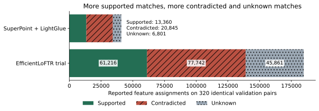
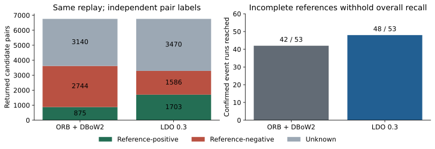

# Results and interpretation

The [machine-readable registry](../../results/index.json) indexes eight historical
studies. Each manifest hashes the original protocol, narrative, and saved evidence.
Compact tables are generated directly from tracked JSON summaries by
[`publish.py`](../../scripts/reproduce/publish.py).

| Study | Findings | Interpretation |
| --- | --- | --- |
| [Pilot](../archive/tartanair-reference-geometry-results.md) | More independently confirmed LDO constraints alongside more accepted pose errors | Short synthetic pilot; not downstream SLAM improvement |
| [Sequential optimization](../archive/ldo-sequential-optimization-results.md) | Confidence-only filtering retained useful evidence; stronger candidate filtering lost events | Keep selection and retention trade-offs visible |
| [Factory/Desert frozen comparison](../archive/ldo-unseen-tartanair-results.md) | LDO reached 48/53 confirmed events; ORB reached 42/53 | Incomplete labels withhold overall recall; later development reuse is explicit |
| [Depth-v2 rescore](../archive/reference-depth-v2-results.md) | Reference coverage increased with additional judged incorrect evidence | New feature evaluator; original detector and pair/event policy preserved |
| [OldTownFall matching test](../archive/ldo-matching-optimization-results.md) | Confidence 0.4 removes 17.3% of contradicted assignments and retains 96.7% supported; useful events fall 13→12 | Keep confidence 0.3 as the research baseline; 0.4 remains experimental |
| [Matching diagnostics](../archive/ldo-matching-diagnostics-results.md) | Some failed pairs have unused supported associations; another has low geometric capacity | Reference-assisted bounds are not recovered model results |
| [Descriptor analysis](../archive/ldo-descriptor-analysis-results.md) | Descriptor ambiguity and assignment opportunities both matter | Does not isolate a single internal causal mechanism |
| [EfficientLoFTR trial](../archive/ldo-image-pair-matching-results.md) | More supported matches and usable pairs, but more contradicted assignments and lower coverage | Failed predeclared promotion; no fresh test or event replay |

## Headline evidence

*All three OldTownFall trajectories, frozen confidence-0.3 and confidence-0.4 LDO,
depth-v2 feature assessment, same retrieval identities. The ≥20-supported-match
event diagnostic is distinct from raw event retrieval and operational acceptance.*

*All 320 identical validation pairs, including 128 positive pairs. EfficientLoFTR
produced more supported, contradicted, and unknown assignments; lower coverage
and more contradicted assignments failed its promotion rules. No model was promoted.*

*All 11 trajectories in the original frozen Factory/Desert experiment. Pair labels
use the original independent overlap policy. These event counts are unaffected
by later feature-only depth-v2 rescoring. References remain incomplete.*

## A representative failure, not a recovered result

*OldTownFall P001, query 13 s and history 8 s. The saved model output has zero
supported and one contradicted assignment. The reference-only geometric diagnostic
finds at most two supported one-to-one associations among existing keypoints;
blue lines are oracle examples, never model inputs or recovered matches. This
example was selected as the low-capacity failure from the four diagnosed events.*

Unknown-inclusive correctness bounds, per-scene tables, failed promotions, and
original evidence paths remain in each study's full report. Counts from different
candidate populations or evaluator versions must not be combined into one table.
