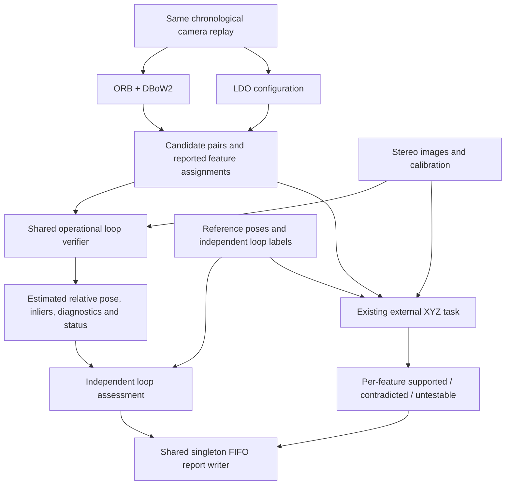

# Plan: verified loop-connection evaluation

Updated: 2026-10-06.

## Objective

Compare ORB + DBoW2 and a replaceable LDO configuration on their ability to provide correct, geometrically usable connections to historical images. Keep candidate retrieval, feature correctness and operational acceptance as separate measurements. Full SLAM tracking and map correction are outside this task.

## Current state

- Implemented: independent reference universe, detector-blind annotation, trace validation, retrieval metrics, identical-pair matching experiments, uncertainty estimates, sequence aggregation and dated reports.
- Prepared: 2,688 reference pairs across 18 selected pose-admitted MH_01 queries. Labels require independent review; do not assume they are complete.
- Verified: real four-pair matching smoke test and existing regression suite; these do not prove loop superiority.
- Implemented: observation-only shared PnP/RANSAC verifier, stereo preparation, offline reference-pose assessment, assignment-level diagnostics and supervised dated reports. Operational and assessment thresholds remain provisional development settings.

## Topology and information boundaries



The operational verifier never reads reference poses, loop labels or XYZ verdicts. Independent loop assessment may read them. Stereo depth is reconstructed from synchronized cameras, not supplied as ground-truth feature depth.

The external XYZ task continues checking all pose-admitted reported correspondences, including those from candidates the operational verifier rejects. Do not restrict feature evaluation to accepted connections; that would bias the feature comparison.

## File ownership

```text
loop_verification/                       # Operational package, independent of evaluation
├── contracts.py                         # Inputs, pose convention and immutable results
├── verifier.py                          # Observation-only verification pipeline
├── stereo_depth.py                      # Calibrated metric depth and reliability
├── pose_estimation.py                   # PnP + RANSAC and pose refinement
├── acceptance.py                        # Shared configurable acceptance rules
└── config.yaml                          # Operational thresholds, no reference policy

src/loop_eval/tasks/loop_closure/
├── PLAN.md
├── config.yaml                          # Existing comparison protocol
├── comparison/                          # Existing reference/metrics workflow
├── verification.py                      # Replay adapter; validates fixed inputs and emits results
├── pose_assessment.py                   # Independent reference-pose comparison
└── loop_metrics.py                      # Verified-connection metrics
```

Task-specific code lives here. Existing orchestrator, benchmark adapters, event publisher and file handler remain shared. Historical artifacts remain immutable. Reusable low-level stereo code may be extracted into an observation-only package if necessary; do not import the whole ground-truth evaluator into runtime verification. Preserve the XYZ numerical regression contract during any extraction.

## Input contract

Each pair includes sequence/camera identities, integer query/history timestamps, synchronized stereo image references, calibration identity, and the detector's reported raw-pixel feature coordinates, assignment IDs and optional confidence metadata.

Validate history order, unique assignments, image coordinate bounds, stereo timestamps and calibration. Do not rematch temporal features or select them using evaluation outcomes. Detector confidence may be recorded but does not change the verifier's rules between methods.

Cache per-frame depth by image, calibration, model and operational-policy hashes so both methods use identical predictions. Report candidates with no matches and unavailable depth explicitly.

## Output contract

Return pair identity, verifier/config/model fingerprints, input hashes, usable-depth count, inlier assignment IDs, residual diagnostics, estimated `T_HQ`, acceptance status and reason codes. `T_HQ` maps current/query camera coordinates into historical camera coordinates: `P_H = R_HQ P_Q + t_HQ`; metric stereo determines translation scale.

Statuses:

- `accepted`: sufficient valid observations support an estimate passing all operational gates.
- `rejected`: an attempted estimate fails an explicit operational gate; this is not automatically a ground-truth false positive.
- `insufficient_evidence`: no reliable estimate can be established, including missing stereo or too few usable observations.
- Execution failures are benchmark errors, not geometric verdicts.

## Operational verification algorithm

1. Obtain reliable metric depth at query-side reported feature pixels from query stereo alone. Do not triangulate the alleged temporal match to create its own supporting depth.
2. Construct query-camera 3D points and their historical-camera 2D observations from the detector's assignments. Use the correct raw-camera intrinsics/distortion or consistently undistorted coordinates.
3. Estimate `T_HQ` using a configured PnP/RANSAC method. Its model is a rigid relative camera pose; RANSAC is appropriate because a transformation now defines correspondence consistency.
4. Refine the estimate on its inliers and recompute residuals. Where independent historical stereo depth is available, record bidirectional or 3D consistency diagnostics under the same frozen rules for both detectors.
5. Apply configurable minimum usable-point/inlier counts, inlier ratio, reprojection error, cheirality and numerical-conditioning gates. Avoid resurrecting image-grid voting as an acceptance rule. Account for degenerate geometry explicitly.
6. Return the estimate, all assignment-level evidence and acceptance reason. Never substitute a reference pose when estimation fails.

The initial implementation should use one query-depth PnP path. Historical-depth diagnostics must not silently introduce a second acceptance path after inspecting test outcomes. Choose numerical gates on development data and save them in a separate operational policy; their values are not fixed by this document.

## Independent assessment

Compute the reference transform only offline:

`T_HQ_ref = inverse(T_WH_ref) * T_WQ_ref`.

Compare the estimated and reference rotations and translations in the same frame and units. Save angular and metric errors, reference timestamp errors and assessment thresholds separately from operational settings. Freeze assessment tolerances before held-out evaluation, considering reference uncertainty.

A known loop label with an inaccurate estimated pose is different from an incorrect candidate pair; report both. An unknown loop label remains unresolved even if a pose estimate looks plausible. Low pose error alone does not prove shared physical scene. Individual XYZ passes do not define reference loop labels.

## Experiments and metrics

1. Retrieval: same replay/history/exclusion/K, independent labels and existing precision/recall metrics.
2. Matching: identical independently selected pairs, normal configurations and equal requested extraction-cap ablation, unchanged XYZ evaluation.
3. Operational verification: both detectors' actual candidates passed to the same frozen verifier. Also run the verifier on the fixed-pair experiment to isolate geometry/matching from retrieval.

Report correct accepted connections, incorrect accepted connections, unresolved accepted connections, rejected/insufficient-evidence counts and pose-error distributions. Distinguish candidate precision from verified-connection precision. For completely labeled queries, measure whether at least one correct connection is accepted and record why opportunities were missed: not retrieved, rejected, insufficient evidence or inaccurate estimated pose. Insufficient evidence is not a false-positive label, but it can explain an operationally missed known opportunity.

Use per-sequence results, equal-sequence aggregates and paired temporal-block uncertainty. Keep unknown coverage visible. Report actual extraction counts and original preprocessing in equal-cap comparisons. Equal-precision threshold sweeps must select operating points on development data and apply them unchanged to held-out data.

## Implementation milestones

- [x] Separate feature and loop evaluation task directories.
- [x] Implement independent reference/comparison workflow and retain external XYZ task.
- [x] Define typed runtime contracts, pose direction and versioned operational/assessment policies.
- [x] Implement calibrated depth preparation and the single PnP/RANSAC path without reference inputs.
- [x] Add refinement, acceptance rules, degeneracy handling and saved diagnostics.
- [x] Connect both benchmark outputs through the loop-task adapter and shared event/report infrastructure.
- [x] Add offline reference-pose assessment and verified-connection metrics to reports.
- [ ] Review independent labels and run controlled development experiments.
- [ ] Freeze configurations, run held-out sequences and assess the claim with uncertainty.

## Validation gates

Use synthetic known-pose projections with noise/outliers to test transform direction, metric scale, distortion handling and rejection. Test insufficient depth, zero matches, invalid timestamps, duplicate assignments, behind-camera points and ill-conditioned geometry. Replay identical pixel/depth inputs through both adapters and require equal verifier results. Test that runtime verification has no dependency on reference files or evaluator verdicts. Retain all XYZ hash/AST regression checks.

Before a scientific claim, confirm independent label completeness, frozen policies, held-out scope, model provenance and training-data overlap status. The software should report missing evidence explicitly rather than automatically declare a winner.

## Running the implemented pipeline

From the project root:

```powershell
uv run python evaluation/compare.py verify --supervised
uv run python evaluation/compare.py verify --query-limit 5
uv run python evaluation/compare.py verify --fixed-checks evaluation/output/fixed_matching_RUNID
```

The supervised command runs the shared benchmark through the orchestrator. The child publishes pair events through the inherited publisher; only the parent singleton FIFO handler writes the dated final JSON/Markdown. Detailed assignment evidence and source/policy snapshots live in the verification artifact directory named in the report.

`configs/verification/config.yaml` controls operational acceptance; `configs/verification/stereo.yaml` controls image-only depth; `assessment.yaml` controls offline pose tolerances. No policy was optimized against independent test labels. Missing labels withhold correctness, precision and recall as appropriate. Fixed-pair verification does not report detector recall.

Reusable stereo observations now live in `stereo_observations/`. The external XYZ formulas and policy are unchanged; regression checks preserve numerical function bodies and pinned stereo worker bytes. Reusing historical caches copies validated image disparities only, never reference poses, world points or XYZ verdicts.

## Development replay result — 2026-10-06

The supervised MH_01 run completed 3,052 pair checks across 323 candidate-bearing eligible queries in 383 seconds. Saved records, IPC events and final counts reconcile.

| Method | Candidate pairs | Accepted | Rejected | Insufficient evidence |
| --- | ---: | ---: | ---: | ---: |
| ORB + DBoW2 | 1,540 | 454 | 56 | 1,030 |
| LDO | 1,512 | 1,071 | 394 | 47 |

Reference pose diagnostics for accepted estimates: 423/454 ORB and 929/1,071 LDO estimates fall within the provisional 0.20 m / 5 degree assessment tolerances. These are pose diagnostics, not independently labeled correct-loop counts. All accepted pair labels are unresolved. The candidate sets differ; this is a configured pipeline comparison, not an identical-pair ablation.

The four-pair equal-cap verification smoke accepted 0 ORB pairs (all insufficient depth evidence) and 1 LDO pair (3 rejected). Four pairs are insufficient for a performance conclusion.

Final report: `evaluation/output/evaluation_2026-10-06_22-18-35_985980_cb90532a.md`; detailed source snapshots and records: `evaluation/output/loop_verification_aa3cd64f8e0b4c3682ac54f2b8122b39/`. Independent labels and held-out experiments remain pending.

## Primary/secondary audit implemented

The `audit` command now joins all external XYZ evidence to a completed shared-verifier report. Rejected and insufficient-evidence candidates retain their feature verdicts in primary totals. The development audit identified 64 strongly XYZ-supported LDO rejects (all low inlier ratio), including 61 reference-accurate estimates under provisional tolerances. See `docs/archive/primary-secondary-evaluation-audit.md` for counts, exact examples and the next calibration experiment. No gate was changed.

## Independent event reference implemented

The main claim now concerns distinct confirmed revisits, with pair and feature outcomes as supporting measurements. `revisits/` owns full-reference preparation, detector-blind review, reviewer consensus, freezing, event metrics and development/held-out operating points. See `docs/archive/independent-revisit-evaluation-plan.md`. No reference labels are invented from pose gates. The initial real full-reference run has 52,326 unknown pairs and correctly withholds loop precision/recall.
